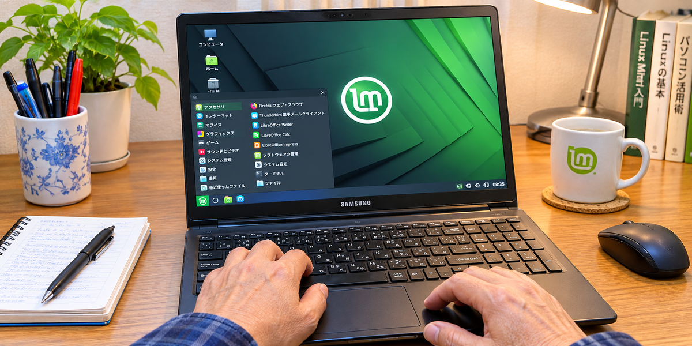
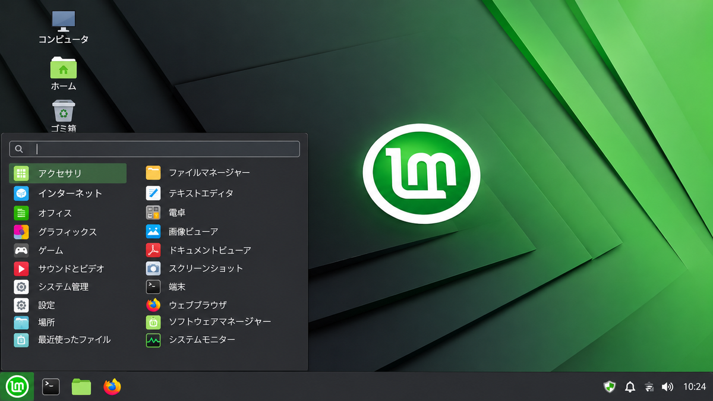
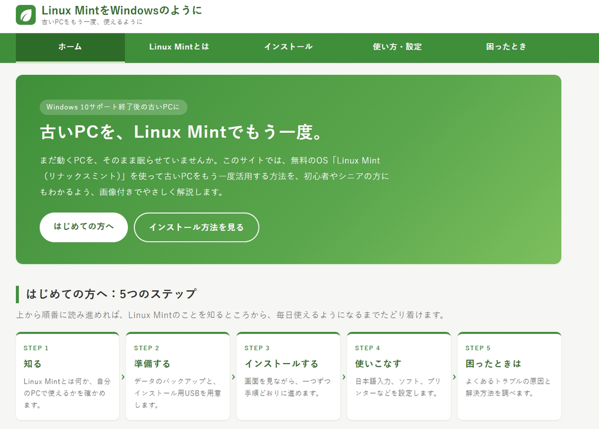

はじめまして。Linux Mint初心者のための日本語ガイドサイト「Linux MintをWindowsのように」を運営している、シン・グァンテ（Shin Gwangtae）です。

このサイトでは、**Windows10のサポート終了で使えなくなった古いPCを、Linux Mint（リナックスミント）でもう一度使えるようにする方法**を、日本語でご案内しています。パソコンにあまり詳しくないLinux Mint初心者の方、とくに私と同じ中高年の方が、順番どおりに進めれば迷わずできるように書いていきます。

先に結論をお伝えすると、このサイトを作った理由は「捨てようとしていたノートPCがLinux Mintでよみがえり、同じ悩みを抱えている方が日本にもたくさんいるはずだと思ったから」です。

この記事では、筆者がどんな人間なのか、なぜ韓国人の私が日本語でLinux Mintを紹介するのか、そしてこのサイトで何が学べるのかをご紹介します。

## 筆者紹介：60代でLinux Mintを始めました

私は韓国・江原道（カンウォンド）の華川（ファチョン）郡に住む60代です。1989年から2019年まで、約30年間、地方公務員として働いてきました。Linux Mintは60代になって初めてインストールした、文字どおりの初心者です。

ただ、パソコンとの縁は長いほうです。

- 1991年、行政の電算化に向けた基礎データ入力の仕事で、初めてXenix（ゼニックス、UNIX系のOS）に触れました。当時はきちんと学べませんでしたが、これが私とLinuxの仲間たちとの最初の出会いでした。
- 1999年、勤めていた華川郡庁のホームページを自分で作りました。
- 2000年、行政の情報化に貢献したとして韓国政府の「新知識人」に選ばれ、情報通信部長官表彰を受けました。
- 退職後は、WordPressやGitHubでホームページを作る方法についての本（韓国語）を出版しました。このサイトもGitHubを使って自分で作っています。

今は作家・市民記者として活動しながら、Linux Mintの入門書も執筆しています。

※画像はイメージです。

## 古いPCをLinux Mintで復活させた話

Windows10のサポートは、2025年10月に終了しました。私が使っていた古いノートPCは、Windows11の動作条件を満たしていませんでした。セキュリティ更新が止まったPCでインターネットを使い続けるのは不安です。かといって、まだ動くノートPCを捨てるのももったいないと感じていました。

そこで見つけたのがLinux Mintです。正直に言うと、それまでLinuxといえば「黒い画面に英語のコマンドを打ち込むもの」だと思っていました。ところが実際にインストールしてみると、画面の下にタスクバーがあり、左下にスタートメニューがあって、Windowsとよく似ていることに大変驚きました。インターネット、文書作成、動画を見るといった普段の作業は十分にこなせます。今ではこのノートPCを、Windows10の代わりにLinux Mintで使っています。

### このサイトで使うPC：2014年製のノートPC

このサイトの記事は、娘が使っていた古いノートPCにLinux Mintを新しくインストールしながら書いていきます。2014年に製造されたサムスンのノートPC（型番NT905S3G）で、これまではChromeOS Flexを入れて使っていたものです。

インストールの準備から設定まで、このPCで一つずつ試し、その画面を記事に載せていく予定です。メーカーは違っても、同じころの古いノートPCをお持ちの方には参考にしていただけるはずです。

※画像はイメージです。



## なぜ日本語でLinux Mint初心者ガイドを作るのか

「韓国人がなぜ日本語のサイトを？」と思われた方もいらっしゃるでしょう。理由は三つあります。

### 1. 物を大切に長く使う日本の方に合うと思ったから

私は公務員時代、日本へ5回出張しました。そのたびに、日本の方々の質素な暮らしぶりや秩序を守る姿勢、伝統を大切にする態度に深く感心しました。

また、日本では今もFAXや紙の書類を大切にしている方が多いと聞きます。インターネットや文書作成、印刷が中心であれば、必ずしも高性能なWindows11のPCに買い替える必要はないのではないか、と私は考えています。NEC、富士通、東芝dynabook、Let's noteなどのノートPCを何年も大切に使っている方にこそ、Linux Mintは良い選択肢になると思いました。

### 2. 初心者向けの日本語の説明がまだ少ないと感じたから

Linuxに関する日本語の記事はたくさんありますが、パソコンに慣れた方向けのものが多いと感じました。「BIOSが何かわからない」「コマンドは怖い」という方が、最初から最後まで迷わずに進められる案内がもっとあればいいと考えています。

### 3. 同じ世代の方の役に立ちたいから

私も60代です。若い人には簡単な説明でも、私にはむずかしいことがありました。だからこそ「60代の初心者である私がつまずいたところ」を基準に説明すれば、同じ世代の方のお役に立てると信じています。

## 日本語のLinux Mint記事の作り方

正直にお伝えします。私は日本語を上手に書くことができません。そのため、このサイトのLinux Mint記事は次の順番で作っています。

1. 実際にLinux Mintで試した内容をもとに、まず韓国語で書きます。
2. 内容が正しいか、もう一度確認します（Linux Mintのバージョン、メニュー名、コマンドなど）。
3. AI「Claude（クロード）」を使った翻訳ツールの助けを借りて日本語にし、メニューやボタンの名前はLinux Mint日本語版の画面表示に合わせます。
4. 画像は、できるだけLinux Mintを日本語表示にした状態で自分で撮影します。

そのため、日本語の表現に少し不自然なところがあるかもしれません。お気づきの点があれば、「お問い合わせ」ページからお知らせいただけるとうれしいです。内容の誤りについても同じです。確認したうえで、すぐに修正します。
{: .note}



## このサイトで学べるLinux Mintの情報（インストール・使い方・トラブル解決）

このサイトではLinux Mintだけを扱います。初心者の方が「インストール前 → インストール → 使い方 → 困ったとき」の順に読めるよう、メニューを分けています。

| メニュー | 内容 |
|---|---|
| Linux Mintとは | Linux Mintとは何か、自分のPCで動くか、何ができるか |
| インストール | 準備するもの、バックアップ、起動USBの作り方、メーカー別のUSB起動方法、インストール手順 |
| 使い方・設定 | 日本語入力（Mozc）、文字を大きくする設定、プリンター、Wi-Fi、よく使うソフト |
| 困ったとき | Wi-Fiがつながらない、音が出ない、日本語入力ができないなどのトラブル解決 |

はじめての方は、まず「初心者向けロードマップ：このサイトの読み方」からお読みください。Linux Mintをどの順番で学べばよいかをまとめています。

## Linux Mint初心者のための当サイトの約束

記事を書くときは、次の四つを守ります。

- **実際に試したことだけを書きます。** 確認していない内容を、体験のように書くことはしません。
- **大げさに書きません。** Linux Mintは良いOSですが、すべてのPCで完璧に動くわけではありません。できないことや欠点も正直に書きます。
- **画像はできるだけ自分で撮影します。** 他のサイトの写真やイラストは使いません。説明のためにイメージ画像を使うときは、そのことを明記します。
- **基準にしたバージョンを書きます。** Linux Mintはバージョンによってメニューが変わることがあるため、記事ごとにどのバージョンを基準にしたかを書きます。

データが消える可能性のある作業（Windowsを消してインストールするなど）には、記事の中で必ず注意書きを入れます。作業の前には、必ずバックアップを取ってください。
{: .warning}

## Linux Mint初心者からよくある質問

### Linux Mintは日本語で使えますか？

はい、使えます。インストールのときに日本語を選べば、メニューが日本語で表示されます。日本語入力（Mozc）も、インストール後に設定すれば使えるようになります。詳しい方法は「日本語環境を完全にする（言語サポートの追加）」と「日本語入力（Mozc）の設定方法」で説明します。

### パソコンに詳しくなくてもインストールできますか？

順番どおりに進めれば初心者の方でもインストールできるよう、画像付きで説明していきます。ただし、PCによってはうまく動かないこともあります。まずはインストールせずに試せる「ライブ起動」で、自分のPCで問題なく動くかを確かめてからインストールすることをおすすめします。

## まとめ

- このサイトは、Windows10のサポート終了で使えなくなった古いPCを、Linux Mintでもう一度使う方法を、Linux Mint初心者や中高年の方に向けて日本語でご案内します。
- 筆者は、30年の公務員生活で行政の情報化やホームページ作りに携わってきた韓国の60代で、自分の古いノートPCをLinux Mintでよみがえらせました。
- 日本語が得意でない分、内容の正確さと実際に試した体験を何より大切にします。誤りがあればお知らせください。すぐに直します。

捨てようとしていたPCが、もう一度使えるPCに変わる喜びを、Linux Mint初心者の皆さんにもぜひ味わっていただければうれしいです。

## 関連記事

- 初心者向けロードマップ：このサイトの読み方
- Linux Mintとは？初心者向けにやさしく解説
- Windows10サポート終了後、古いPCはどうする？
- インストールせずにLinux Mintを試す方法（ライブ起動）
