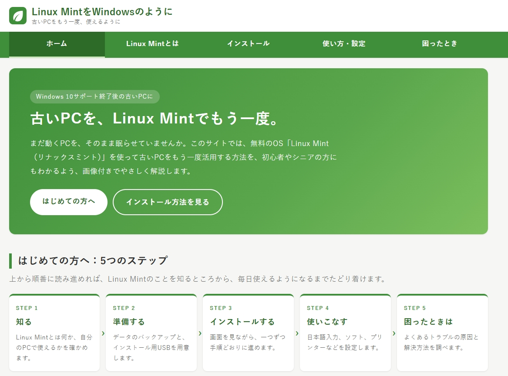
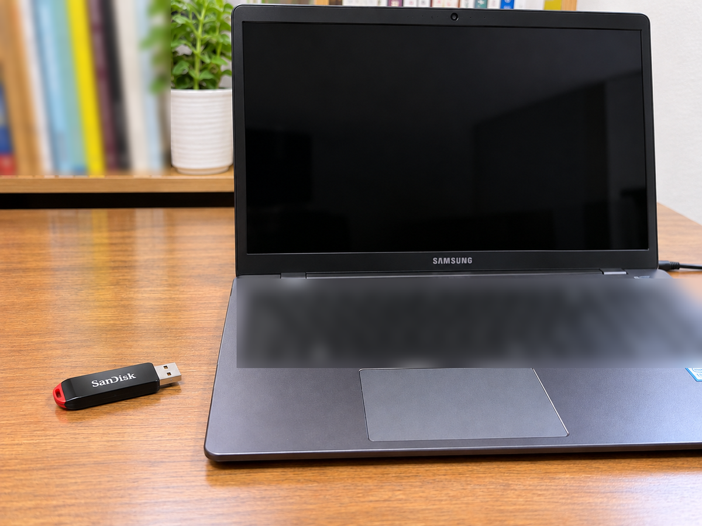
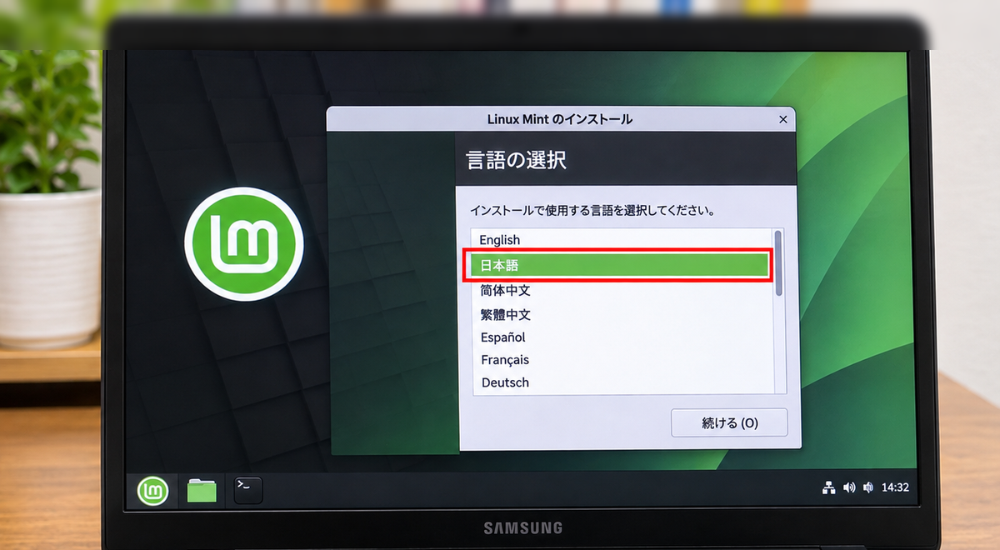

「Linux Mintを使ってみたいけれど、何から読めばいいのかわからない」。この記事は、そんなLinux Mint初心者の方のための始め方ガイドであり、このサイトのロードマップ（道しるべ）です。

先に結論をお伝えすると、**「知る → 準備する → インストールする → 使いこなす → 困ったときは」の5つのステップを、順番に読み進めていただければ大丈夫です。** ステップごとに必ず読んでおきたい記事だけを選んでいますので、最初からすべての記事を読む必要はありません。

この記事は、次のような方に向けて書いています。

- Windows10のサポート終了で、古いPC（ノートPC・デスクトップPC）をどうするか迷っている方
- Linuxという言葉は聞いたことがあるけれど、何から始めればいいかわからない方
- インストールの途中で迷わないよう、まず全体の手順を知っておきたい方

## Linux Mintの始め方：全体の流れを一目で確認

古いPCにLinux Mintを入れて使えるようになるまでの流れは、次の5つのステップです。ノートPCでもデスクトップPCでも、手順は同じです。サイト上部のメニューも、この順番に合わせて分けています。

| ステップ | やること | メニュー |
|---|---|---|
| STEP1 知る | Linux Mintとは何か、自分のPCで使えるかを確認 | Linux Mintとは |
| STEP2 準備する | データのバックアップ、ISOファイルのダウンロード、インストール用USBの作成 | インストール（準備・起動USB・BIOS） |
| STEP3 インストールする | Linux Mintのインストールと、インストール直後の基本設定 | インストール（インストール・インストール後） |
| STEP4 使いこなす | 日本語入力、インターネット、文書作成、プリンターなど毎日使う設定 | 使い方・設定 |
| STEP5 困ったときは | Wi-Fi・音・日本語入力などがうまくいかないときの解決方法 | 困ったとき |

最初の一度だけSTEP1からSTEP3までを順番に進めれば、あとは必要なときにSTEP4とSTEP5の記事を探して読めば十分です。

ちなみに筆者の場合、準備を始めてからインストールが終わるまで、全部で2時間ほどでした。ネットの記事を参考にしながら進めたところ、大きくつまずくことはありませんでした。順番さえわかっていれば、初心者でも決して難しくありません。このロードマップは、その「順番」をまとめたものです。

## STEP1 知る：自分のPCでLinux Mintは使える？

まずは、Linux Mintがどんなものか、そして自分のPCで動くかを確認します。インストールを始める前に「できること・できないこと」を知っておくと、あとで「こんなはずではなかった」ということを減らせます。

**まず読んでおきたい記事**

- Linux Mintとは？初心者向けにやさしく解説
- Windows10サポート終了後、古いPCはどうする？
- Windows11が非対応のPCでもLinux Mintは動く？
- Linux Mintの必要スペック（動作環境）

**必要に応じて読む記事**

- Cinnamon・MATE・Xfce エディションの違いと選び方（どれをダウンロードするか迷ったとき）
- Linux MintでOfficeは使える？Word・Excelファイルの扱い（Word・Excelのファイルをよく使う方）
- Linux Mintでできること・できないこと
- 自分のPCでLinux Mintが動くか確認する方法

このステップでは、PCのメモリやストレージ（保存容量）が必要スペックを満たしているか、そして毎日使っているソフト（年賀状ソフトや、会社の専用ソフトなど）にLinux Mintで代わりになる方法があるかを確認しておきましょう。
{: .point}



## STEP2 準備する：バックアップとインストール用USBの作成

インストールの前にやることは三つです。大切なデータをバックアップすること、Linux Mintのインストール用ファイル（ISOファイル）をダウンロードすること、そしてそれをUSBメモリに書き込んで「インストール用USB」を作ることです。

**順番に読む記事**

1. インストール前に準備するもの一覧（8GB以上のUSBメモリなど）
2. 大切なデータのバックアップ方法（Windows側）
3. Linux MintのISOファイルをダウンロードする方法
4. Rufusで起動USBを作る方法（Windows）
5. BIOS・UEFI設定画面の入り方【メーカー別一覧】
6. メーカー別のUSB起動方法：「NEC・富士通のPCをUSBから起動する方法」「東芝dynabook・パナソニックLet's noteをUSBから起動する方法」「Lenovo・HP・DellのPCをUSBから起動する方法」（ご自分のPCのメーカーの記事だけで大丈夫です。デスクトップPCも同じ記事をご覧ください）

**デスクトップPCをお使いの方へ**：インストール用USBは、本体の前面よりも**背面のUSB端子**に挿すことをおすすめします。背面の端子はマザーボード（PCの中心となる基板）に直接つながっているため、USBからの起動がうまくいきやすいことがあります。また、BIOS画面ではワイヤレスキーボードが反応しないこともあるため、有線のキーボードを使うと確実です。

**まず試してみたい方へ**：「インストールせずにLinux Mintを試す方法（ライブ起動）」をおすすめします。インストール用USBからPCを起動すると、PCの中のデータに手を加えずに、Linux Mintをそのまま使ってみることができます。画面の表示、Wi-Fi、音が自分のPCで問題なく使えるかを事前に確かめられるので安心です。

バックアップは、必ずこのステップで済ませておいてください。インストールの方法によっては、PCの中のデータがすべて消えてしまうことがあります。
{: .warning}

※画像はイメージです。

## STEP3 インストールする：Linux Mintのインストールと最初の設定

準備ができたら、いよいよインストールです。インストール作業そのものは、画面の案内に沿ってボタンを押していく形なので、思ったほど難しくありません。筆者が自分のノートPCにインストールしたときは、インストール作業は30分もかからずに終わりました（かかる時間はPCの性能によって変わります）。ただし、「Windowsを消すか、残すか」だけは、インストールの前に決めておきましょう。

**順番に読む記事**

1. Linux Mintインストール手順【画像付き完全ガイド】
2. インストール時の言語・キーボード・タイムゾーン設定
3. Windowsを消してLinux Mintだけにする方法（古いPCにはこの方法がおすすめです）

Windowsも残しておきたい方は、「WindowsとLinux Mintのデュアルブート」をお読みください。ただし、初心者の方には少しむずかしい方法です。

**インストール直後に必ずやること**

- インストール直後にやること10選
- アップデートマネージャーの初期設定
- Timeshiftでシステムのバックアップを設定する（トラブルが起きたときに元に戻せるように）

※画像はイメージです。

## STEP4 使いこなす：日本語入力と毎日使う設定

インストールが終わったら、毎日使いやすいように設定していきます。最初は日本語入力の設定から始めるのがおすすめです。日本語が入力できないと、検索もメールも不便だからです。

**最初にやっておきたい設定**

1. 日本語環境を完全にする（言語サポートの追加）
2. 日本語入力（Mozc）の設定方法
3. 半角/全角キーで日本語入力を切り替える
4. Wi-Fiに接続する方法（ノートPC、無線LANのあるデスクトップPC）
5. 文字を大きくして見やすくする設定（シニア向け）

**デスクトップPCは、まずインターネットの接続を確認しましょう。** LANケーブル（有線LAN）でつないでいるデスクトップPCは、ほとんどの場合、ケーブルを挿すだけですぐにインターネットが使えます。反対に、無線LANが付いていないデスクトップPCでWi-Fiを使うには、USB接続の無線LAN子機が必要です。大きなモニターで文字が小さく感じるときは、「文字を大きくして見やすくする設定」と「画面の明るさ・解像度を変更する」もあわせてご覧ください。

**やりたいことに合わせて読む記事**

- インターネット：Google Chromeのインストール方法
- 文書作成：LibreOfficeでWord・Excelファイルを開く・保存する
- ソフトを入れる：ソフトウェアマネージャーの使い方
- 印刷：プリンターの設定方法（エプソン）／プリンターの設定方法（キヤノン）
- 家族との連絡：LINEはLinux Mintで使える？代わりの方法
- お手入れ：アップデートの正しいやり方／古いPCの動作を軽くする設定



## STEP5 困ったときは：トラブルが起きたら最初に見る場所

古いPCでは、Wi-Fiがつながらない、音が出ないといったトラブルが起きることがあります。慌てずに、サイト上部のメニュー「困ったとき」から、症状に合った記事を探してください。

| こんなとき | 読む記事 |
|---|---|
| USBから起動しない | USBから起動しないときの対処法 |
| インストール画面が真っ黒・止まる | インストール画面が真っ黒・止まるとき |
| Wi-Fiがつながらない | Wi-Fiがつながらないときの対処法 |
| 有線LANがつながらない（デスクトップPC） | 有線LANが認識されないとき |
| モニターの表示がおかしい | 画面がちらつく・解像度がおかしいとき／外部モニターが映らないとき |
| 音が出ない | 音が出ないときの対処法 |
| 日本語が入力できない | 日本語入力ができないときの対処法 |
| 画面が固まった | 画面が固まった（フリーズした）ときの対処法 |
| 動作が重い | 動作が重いと感じたときのチェック項目 |
| プリンターが認識されない | プリンターが認識されないとき |

**探している記事が見つからないとき**：画面右側（スマートフォンでは下のほう）の「カテゴリー」から分類ごとに探すか、「お問い合わせ」からお知らせください。多くいただいた質問は、新しい記事にまとめていきます。

## 状況別のおすすめの読み方

すべての方が同じ順番で読む必要はありません。ご自分の状況に合わせて選んでください。

**① まずは試してみたいだけの方**

準備するもの一覧 → ISOファイルのダウンロード → 起動USBの作成 → BIOS画面の入り方 → ライブ起動。PCの中のデータには手を加えません。

**② 古いPCをLinux Mint専用にしたい方（いちばん一般的）**

STEP1 → データのバックアップ → STEP2 → Windowsを消してLinux Mintだけにする方法 → インストール直後にやること10選 → 日本語環境・日本語入力の設定。

**③ Windowsも残しておきたい方**

STEP1 → データのバックアップ → STEP2 → WindowsとLinux Mintのデュアルブート → インストール直後にやること10選。

## Linux Mint初心者がつまずきやすいポイント

### 必ず順番どおりに読まないといけませんか？

STEP2とSTEP3は、順番どおりに進めてください。特にバックアップを飛ばすと、大切なデータを失うおそれがあります。STEP4とSTEP5は、必要な記事だけを選んで読んでいただいてかまいません。

### ロードマップにある記事がまだ開けません

このサイトでは、記事を1日1〜2本ずつ順番に公開しています。リンクが付いていない記事は準備中です。このロードマップは、新しい記事を公開するたびにリンクを追加していきます。

### デスクトップPCでも同じ手順でいいですか？

はい。このサイトのインストール手順は、ノートPCでもデスクトップPCでも同じです。違うのは、インターネットの接続（有線LANが多い）、USBを挿す場所（本体背面がおすすめ）、モニターの設定くらいで、それぞれ該当する記事で説明します。自作PCの場合は、マザーボードのメーカー（ASUS、MSI、GIGABYTEなど）ごとのBIOSキーを「BIOS・UEFI設定画面の入り方【メーカー別一覧】」で確認してください。

### 自分のPCのメーカーのUSB起動の記事がありません

「BIOS・UEFI設定画面の入り方【メーカー別一覧】」で、ノートPC・デスクトップPCの主なメーカーのキーをまとめます。まずはその記事をご確認ください。

## まとめ

- Linux Mint初心者の始め方は、「知る → 準備する → インストールする → 使いこなす → 困ったときは」の5つのステップです。
- 最初はSTEP1〜3を順番に進め、そのあとはSTEP4・5を必要なときに読めば大丈夫です。
- インストールの前には必ずバックアップを。自信がなければ、まずはライブ起動で試してみてください。

このロードマップのページをブックマーク（お気に入り）に入れておけば、途中で迷ったときにいつでも戻ってこられます。

## 関連記事

- [Linux Mint初心者向け日本語ガイド｜韓国人の私がこのサイトを作った理由](/guide/001-linux-mint-beginner-guide/)
- Linux Mintとは？初心者向けにやさしく解説
- インストール前に準備するもの一覧
- インストールせずにLinux Mintを試す方法（ライブ起動）
