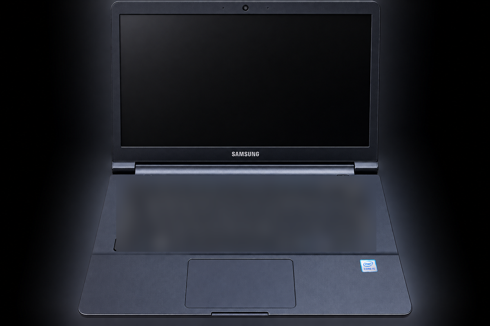
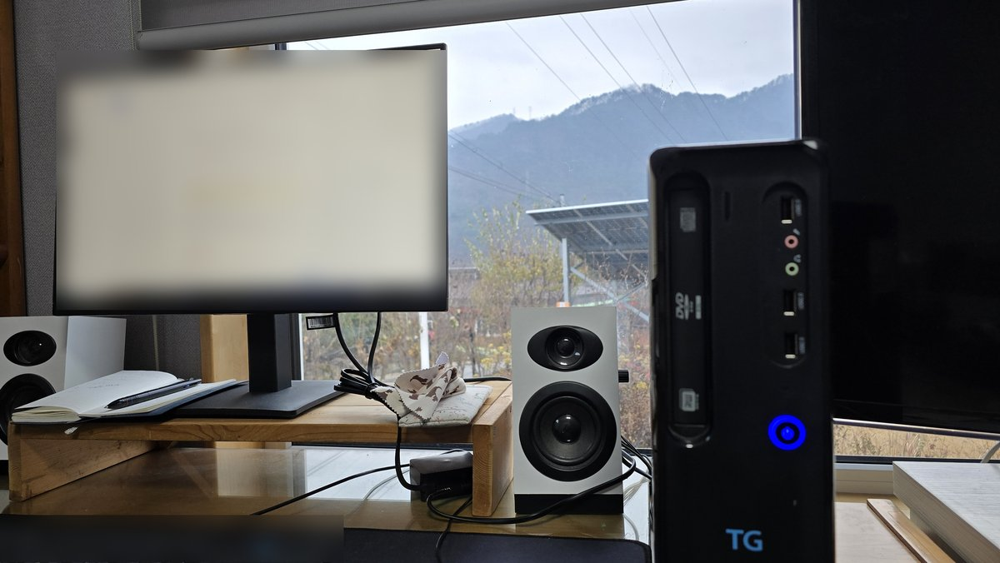

このサイトの記事は、すべて筆者が実際に持っている古いPCでLinux Mintを試しながら書いています。この記事では、そのPCと使用環境をご紹介します。

先に結論をお伝えすると、**このサイトの基準PCは、2014年に製造されたサムスンのノートPC（NT905S3G）です。** Windows11をインストールできない、文字どおりの「古いPC」です。インストールから日本語の設定まで、このPCで一つずつ確かめていきます。

この記事は、次のような方に向けて書いています。

- 自分のPCが筆者のPCと似ているか、比べてみたい方
- 10年以上前のノートPCやデスクトップPCで、Linux Mintが使えるのか気になっている方
- このサイトの記事が、どんな環境で確かめたものかを知りたい方

## 筆者のPCを一覧で紹介（Linux Mintを試す古いPC）

筆者が今使っているPCは、次の3台です。

| PC | 製造年 | 主な仕様 | OS | このサイトでの役割 |
|---|---|---|---|---|
| サムスンのノートPC NT905S3G（娘が大学時代に使っていたもの） | 2014年 | メモリ4GB | ChromeOS Flex → Linux Mintをインストール予定 | 基準PC（インストール・設定画面の撮影） |
| サムスンの中古ノートPC | 2010年代前半（推定） | メモリ8GB（4GB増設） | Linux Mint（2026年10月にインストール） | 筆者が初めてLinux Mintを入れたPC |
| TGサンボのデスクトップPC（中古で購入） | 2019年 | Core i5-9500／メモリ8GB／SSD 256GB | Windows11 | 起動USBの作成、記事や画像の作業 |

このうち2台のノートPCは、どちらもWindows11の動作条件を満たしていません。

## メインのPC：2014年製のノートPC（サムスン NT905S3G）

このサイトのインストールや設定の記事は、このノートPCで確かめます。娘が大学時代に使っていたもので、最近はChromeOS Flexを入れて使っていました。今回、ChromeOS Flexを消してLinux Mintを新しくインストールし、準備からインストール、日本語の設定まで、すべての手順を写真に残していく予定です。

今の状態を正直にお伝えすると、バッテリーはすぐに切れてしまうため、電源につないだまま使っています。メモリは4GBですが、ChromeOS Flexでの動作は遅いと感じませんでした。Linux Mintは、Windowsにいちばん近い見た目の「Cinnamon（シナモン）」エディションを入れて試します。

サムスンのノートPCは、日本ではあまり見かけないメーカーだと思います。それでも、同じころ（2013〜2015年ごろ）に発売されたNEC、富士通、東芝dynabookなどのノートPCをお持ちの方には、性能が近いことが多く、参考にしていただけるはずです。メーカーによって違うBIOSの入り方などは、メーカー別の記事で別にご案内します。

**このPCを基準にした理由**

- Windows11をインストールできないPCなので、このサイトを読んでくださる方と同じ立場だからです。
- 10年以上前のPCでLinux Mintがどのくらい動くのかを、そのままお見せできるからです。



## 筆者が初めてLinux Mintを入れた中古ノートPC

筆者が初めてLinux Mintをインストールしたのは、中古で買ったサムスンのノートPCです。2010年代前半に製造されたと思われる機種で、メモリを4GB増設して合計8GBにし、Windows10で使ってきました。

Windows10のサポートが終わり、Windows11はインストールできないとわかったため、2026年10月にLinux Mintをインストールしました。準備からインストール完了までは約2時間、インストール作業そのものは30分もかかりませんでした。

使い始めたときは、不安よりも「新しいことを覚えられる」という楽しみのほうが大きかったです。起動の速さやYouTubeの視聴には、まったく不便を感じていません。メモリを8GBにしていることも大きいと思います。今はこのノートPCを職場で使っていて、とても満足しています。

一方で、不便に感じたこともあります。Windowsでは画面キャプチャーに「PicPick」、写真の編集に「PhotoScape X」を使い慣れていたので、最初はその代わりが見つからず戸惑いました。たとえばFirefoxにスクリーンショット機能があると知るまでは、PicPickのようにページ全体をキャプチャーする方法がわかりませんでした。こうした代わりのソフトについても、これから試して記事にしていきます。

## デスクトップPC：2019年製のWindows11デスクトップ

以前は2012年製のデスクトップPCも使っていましたが、正直に言うと、筆者にはWindows11も必要だと考え、手放しました。代わりに、2019年製のデスクトップPC（韓国のメーカー・TGサンボの完成品）を中古で購入し、Windows11で使っています。モニターは16:9の新しいものです。

「Linux Mintをすすめるサイトなのに？」と思われるかもしれません。ですが、使い方によってはWindows11が必要な場合もあります。大切なのは、自分の使い方に合った方法を選ぶことだと筆者は考えています。

このPCでは、Linux Mintの起動USBを作ったり（Rufus）、このサイトの記事や画像を整理したりしています。また、このサイトはノートPCだけでなく、デスクトップPCをお使いの方にも読んでいただけるように書いています。有線LANでの接続や本体背面のUSB端子など、デスクトップPCならではの注意点も、記事の中で取り上げていきます。



## このサイトの基準環境（Linux Mintのバージョン）

このサイトの記事は、次の環境を基準に書いています。

| 項目 | 基準 |
|---|---|
| Linux Mintのバージョン | 22.3「Zena」（2026年1月公開、2029年までサポート） |
| エディション | Cinnamon（Windowsにいちばん近い見た目） |
| 表示言語 | 日本語（メニューやボタンの名前は、日本語版の画面表示どおりに書きます） |
| 日本語入力 | Mozc |

Linux Mintは、バージョンによってメニューの名前や画面が少しずつ変わることがあります。そのため、記事ごとに上部へ「対象：Linux Mint 22.3」のように、基準にしたバージョンを表示しています。

Linux Mintの開発チームは、次のバージョンを「Linux Mint 27」という名前で、2026年のクリスマスごろに公開する予定だと発表しています。インストール用のプログラムも変わる予定のため、新しいバージョンが出たら、インストール関連の記事から順番に確認して修正します。
{: .note}

## よくある質問

### 自分のPCは筆者のPCとメーカーも性能も違いますが、参考になりますか？

Linux Mintのインストール手順や使い方は、メーカーに関係なくほとんど同じです。違うのは、BIOSに入るためのキーやUSBから起動する方法くらいで、これはメーカー別の記事で別にご案内します。自分のPCで動くか心配な方は、まず必要スペックの記事をご確認ください。

### 筆者のPCより古いPCでも使えますか？

64bitのCPUで、メモリが2GB以上（快適に使うなら4GB以上）あればインストールできます。ただし、とても古い32bitのPCでは、今のLinux Mintは使えません。詳しくは、必要スペックの記事と32bitのPCについての記事で説明します。

## まとめ

- このサイトのLinux Mintの記事は、Windows11をインストールできない古いPCで、実際に試しながら書いています。
- 基準PCは、2014年製のサムスンのノートPC（NT905S3G、メモリ4GB）です。
- 基準バージョンはLinux Mint 22.3のCinnamonエディションで、新しいバージョンが出たら記事を順番に見直します。

筆者のPCと同じころのPCをお持ちでしたら、ぜひこのサイトの記事どおりに試してみてください。

## 関連記事

- [Linux Mint初心者向け日本語ガイド｜韓国人の私がこのサイトを作った理由](/guide/001-linux-mint-beginner-guide/)
- [Linux Mintの始め方【初心者向けロードマップ】このサイトの読み方](/guide/002-linux-mint-beginner-roadmap/)
- Linux Mintの必要スペック（動作環境）
- 自分のPCでLinux Mintが動くか確認する方法
- ChromeOS FlexとLinux Mintを両方使って比べてみた
