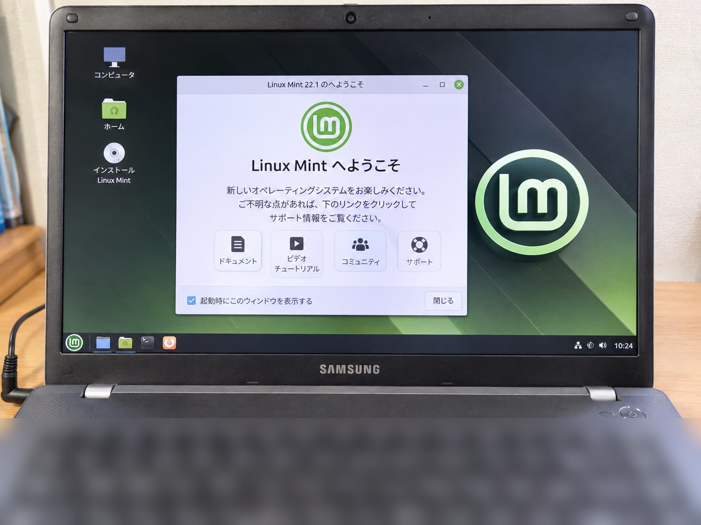

「60代になってLinuxなんて、自分には無理だろう」。もしそう思っているなら、まずはこの記事を読んでみてください。筆者も、60代になって初めてLinux Mintをインストールした初心者です。

先に結論をお伝えすると、筆者がLinux Mintを始めたきっかけは、**「Windows11をインストールできないノートPCを、捨てたくなかったから」**です。そして実際にやってみると、不安よりも新しいことを覚える楽しみのほうがずっと大きかったのです。

この記事は、次のような方に向けて書いています。

- 年齢を理由に、新しいOSを覚えるのをためらっている方
- Windows10のサポート終了後、古いPCをどうするか迷っている中高年の方
- このサイトを書いているのがどんな人なのか、知りたい方

## きっかけはWindows10のサポート終了と、捨てられないノートPC

2025年10月、Windows10のサポートが終了しました。筆者が使っていた中古のノートPCは、2010年代前半に製造されたと思われる機種ですが、メモリを増設していたので、インターネットや文書作成には何の不便もありませんでした。

ところが、Windows11にしようとしたところ、このノートPCは動作条件を満たしていませんでした。セキュリティ更新が止まったPCでインターネットを使い続けるのは不安です。かといって、まだ普通に動くノートPCを捨てるのは、あまりにももったいないと感じました。

さらに最近は、半導体の値上がりの影響で、PCやノートPCの価格も大きく上がっています。振り返ってみると、筆者がWindowsで使っていたのは、インターネット、YouTube、文書作成、ブログの更新くらいでした。Windowsでなければ動かないソフトは、ほとんどありません。「それなのに、わざわざWindows11のために新しいPCを買う必要があるのだろうか」と疑問に思ったのです。

実はLinuxという名前自体は、2000年代から知っていました。ただ、当時は「自分にはむずかしそうだ」と思い、手を出しませんでした。そんな中、2026年になって「Linux MintはWindowsによく似たOSだ」という話を耳にしたのが、始めるきっかけになりました。

## 30年の公務員生活で続いたパソコンとの縁

筆者は1989年から30年間、地方公務員として働きました。その間、パソコンとはかなり深い縁がありました。

- 1991年、行政の電算化に向けた基礎データ入力の仕事で、初めてXenix（ゼニックス、UNIX系のOS）に触れました。当時は、きちんと学ばないまま終わってしまいました。
- 1999年、勤めていた華川（ファチョン）郡庁のホームページを自分で作りました。
- 退職後は、WordPressやGitHubでホームページを作る方法についての本を出版しました。

パソコンには慣れているほうでしたが、それでもLinuxには長い間「むずかしそう」というイメージを持っていました。



## なぜLinux Mintを選んだのか

Windows11をインストールできないPCを使い続ける方法は、いくつかあります。その中で筆者がLinux Mintを選んだ理由は、次の三つです。

- **Windowsと画面がよく似ています。** 画面の下にタスクバー、左下にスタートメニューがあり、初めて見ても、どこを押せばいいか見当がつきます。
- **無料です。** 新しいPCを買わずに済み、OSにもお金がかかりません。
- **古いPCでも軽く動きます。** 筆者のノートPCでも、起動やYouTubeの視聴で不便を感じませんでした。

Ubuntu（ウブントゥ）など、ほかのLinuxの名前も聞いたことはありました。それでもLinux Mintを選んだのは、Windowsを使ってきた人でも抵抗なくなじめるOSだと考えたからです。

実は筆者は、娘が使っていた2014年製のノートPCに、ChromeOS Flex（Googleが提供する無料のOS）を入れて使ってみたこともあります。ChromeOS Flexも軽くて良いOSですが、インターネットにつながっていることが前提のOSなので、事務作業や文書作成、画像の編集などをするには物足りなさを感じました。また、Windowsに慣れた人には、少しなじみにくい環境だと思います。一方Linux Mintなら、Windowsでやっていた基本的な作業を、ほとんど不便なくこなせます。

## 初めて使ってみて感じたこと：不安より楽しみのほうが大きかった

正直に言うと、それまで筆者にとってLinuxは「黒い画面に英語のコマンドを打ち込むもの」というイメージでした。ところが2026年10月、実際にインストールしてみると、Windowsとそっくりで驚きました。

インストール作業は1時間もかからずに終わりました。ネットのブログ記事を参考にしながら進めましたが、大きくつまずくところはありませんでした。

新しいOSを使う不安よりも、「新しいことを覚えられる」という楽しみのほうが大きかったです。起動の速さやYouTubeの視聴もまったく問題なく、今はこのノートPCを職場で満足して使っています。

もちろん、不便に感じたこともあります。Windowsで使い慣れていた「PicPick」（画面キャプチャー）や「PhotoScape X」（写真編集）の代わりになるソフトを探すのに、時間がかかりました。こうした「Windowsで使っていたあのソフトは？」という疑問には、このサイトで順番にお答えしていきます。



## 60代で新しいOSを学んでわかったこと（シニアの方へ）

60代になると、新しいことを覚えるのに時間がかかるのは事実です。それでも、Linux Mintを使ってみて、同じ世代の方にお伝えしたいことができました。

- **一度に全部やろうとしなくて大丈夫です。** 今日はインストール用USBを作る、明日はインストールする、というように分けて進めれば、負担が軽くなります。
- **まずは試してみてください。** インストールせずにUSBからLinux Mintを使ってみる方法（ライブ起動）があるので、PCの中のデータに手を加えずに試せます。
- **わからないことはメモしておきましょう。** 筆者は、スマートフォンのメモや、自分宛てのメールに、手順や気づいたことを残しています。
- **AIに聞くのも一つの方法です。** 今はAIに質問すれば、わからない言葉や操作をていねいに教えてくれます。筆者も、正直なところ大きく困ることはありませんでした。

筆者がこのサイトを「60代の初心者がつまずいたところ」を基準に書いているのも、そのためです。

## この経験を本と日本語サイトに

Linux MintでノートPCがよみがえる体験をして、筆者はこれをほかの人にも伝えたいと思うようになりました。そこで今、韓国語でLinux Mintの入門書を書いています。そして、同じ悩みを持つ日本の方のために、このサイトを作りました。

日本にも、PCを長く大切に使っている方が多いと思います。捨てようとしていたPCが、もう一度使えるPCに変わる喜びを、このサイトを通して一緒に分かち合えればうれしいです。

## よくある質問

### パソコンに詳しくない60代・70代でもLinux Mintは使えますか？

インターネット、メール、文書作成、動画など、普段やっていることなら十分に使えると思います。ただし、インストールのときにはBIOSの設定など、初めて見る画面が出てきます。最初はご家族や知り合いの方と一緒に進めると、より安心です。詳しくは「高齢者でも使える？60代の筆者の正直な感想」の記事でお伝えします。

## まとめ

- 60代の筆者がLinux Mintを始めたきっかけは、Windows11をインストールできないノートPCを捨てたくなかったことでした。
- Windowsに似た画面、無料であること、古いPCでも軽く動くことが、Linux Mintを選んだ理由です。
- 実際に使ってみると、不安より楽しみのほうが大きく、その体験を本とこのサイトでお伝えしています。

年齢は、新しいことを始められない理由にはなりません。一緒に、ゆっくり始めてみましょう。

## 関連記事

- [Linux Mint初心者向け日本語ガイド｜韓国人の私がこのサイトを作った理由](/guide/001-linux-mint-beginner-guide/)
- [Linux Mintの始め方【初心者向けロードマップ】このサイトの読み方](/guide/002-linux-mint-beginner-roadmap/)
- [Linux Mintを試す筆者のPC環境｜2014年製ノートPCなど古いPCを紹介](/guide/003-my-pc-environment/)
- 高齢者でも使える？60代の筆者の正直な感想
- インストールせずにLinux Mintを試す方法（ライブ起動）
