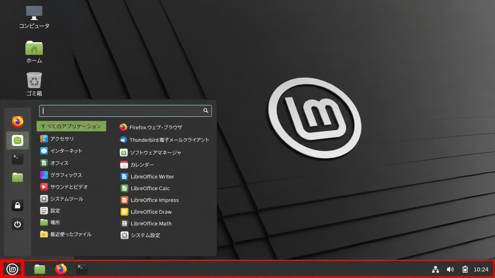

「Linux Mintという名前は聞いたことがあるけれど、いったい何なのかよくわからない」。この記事では、そんな方のために、Linux Mintとは何かを最初からやさしく解説します。

先に結論をお伝えすると、**Linux Mint（リナックスミント）は、Windowsの代わりにPCに入れて使える無料のOSです。画面や使い方がWindowsに似ているので、初心者が始めやすいLinuxです。** Windows11をインストールできない古いノートPCやデスクトップPCも、もう一度使えるようにしてくれます。

この記事は、次のような方に向けて書いています。

- Linux Mintという言葉を初めて聞いた方、名前だけ知っている方
- Windows10のサポートが終わり、Windows11にアップグレードできない古いPCのために、代わりのOSを探している方
- インストールする前に、Linux Mintがどんなものかを知っておきたい方

## Linux Mintとは？ひとことで言うと「Windowsの代わりになる無料のOS」

PCを動かすための基本のソフトウェアを、OS（オペレーティングシステム）といいます。WindowsやmacOSが代表的なOSです。Linux MintもそうしたOSの一つで、Windowsの代わりにPCにインストールして使うことができます。

Linux Mintの特徴を表にまとめると、次のとおりです。

| 項目 | Linux Mint |
|---|---|
| 料金 | 無料（ライセンス料は不要） |
| 画面 | Windowsに似ている（画面下にタスクバー、左下にスタートメニュー） |
| 使えるPC | 一般的なノートPC・デスクトップPC（古いPCも含む） |
| できること | インターネット、メール、文書作成、動画・音楽、写真の閲覧と簡単な編集など |
| 日本語 | メニューの日本語表示も、日本語入力も可能 |

「Linux」と聞くと、黒い画面にコマンドを打ち込む姿を思い浮かべる方が多いかもしれません。筆者もそうでした。ですがLinux Mintは、マウスでメニューを選んで使う、Windowsとほとんど同じ感覚のOSです。

## 誰が作っている？LinuxやUbuntuとの関係

Linux Mintは2006年に最初のバージョンが公開され、クレマン・ルフェーヴル（Clément Lefebvre）氏を中心とした開発チームが作っています。会社が販売している製品ではなく、利用者からの寄付やスポンサーの支援で運営されているプロジェクトです。

関係を整理すると、次のようになります。

- **Linux（リナックス）**：OSのいちばん中心となる部分（カーネル）の名前です。これをもとに作られたさまざまなOSを、まとめて「Linux」と呼んでいます。
- **Ubuntu（ウブントゥ）**：Linuxをもとに作られたOSの中で、世界中で広く使われているものです。
- **Linux Mint**：Ubuntuをもとに、Windowsに慣れた人でも使いやすいように仕上げたOSです。

Ubuntuをもとにしているので、Ubuntu向けに作られた多くのソフトを、Linux Mintでも使うことができます。LinuxとWindowsの違いについては、「そもそもLinuxとは？Windowsとの違い」の記事でくわしく説明します。



## Linux Mintの5つの特徴

### 1. Windowsに似た画面

画面の下にタスクバー（Linux Mintでは「パネル」と呼びます）、左下にスタートメニューがあります。Windowsを使ってきた方なら、初めて見てもどこを押せばいいか見当がつきます。

筆者が初めて使ったときは、スタートメニューの形や、パネルにあるターミナル（文字で操作する画面）のアイコン、ブラウザのFirefox（ファイアフォックス）など、初めて目にするものもありました。それでも、全体の使い方はWindowsとほとんど変わらないと感じました。

### 2. 無料で、広告もない

Linux Mintは、ダウンロードもインストールもアップデートも無料です。OSの中に広告が表示されることもありません。

### 3. 古いPCでも軽く動く

Windows11は比較的新しいPCでないとインストールできませんが、Linux Mintは64bitのCPUとメモリ2GB以上があればインストールできます。筆者の2010年代前半のノートPCでも、起動やYouTubeの視聴で不便を感じませんでした。

### 4. 必要なソフトが最初から入っている

インストールするだけで、すぐに使えるソフトが入っています。

- インターネット：Firefox。Google ChromeやMicrosoft Edgeを追加でインストールすることもできます。
- 文書作成・表計算：LibreOffice（リブレオフィス）。WordやExcelのファイルも開けて、使い方もWord・Excelとよく似ています。
- メール：Thunderbird（サンダーバード）。Gmailなども問題なく使えます。
- 動画・音楽の再生、写真の閲覧

筆者がLinux Mintで最初にしたのは、Firefoxを使ってGoogle Chromeをインストールすることでした。

ほかに必要なソフトは、「ソフトウェアマネージャー」から、スマートフォンのアプリストアのように選んでインストールできます。

### 5. アップデートとバックアップが簡単

「アップデートマネージャー」でセキュリティ更新を受け取り、「Timeshift（タイムシフト）」でシステムのバックアップを取っておけば、トラブルが起きたときに以前の状態に戻すことができます。

## 3つのエディション（Cinnamon・MATE・Xfce）

Linux Mintには、画面の見た目や軽さが異なる三つのエディション（種類）があります。ダウンロードするときに、どれか一つを選びます。

| エディション | 特徴 | こんな方に |
|---|---|---|
| Cinnamon（シナモン） | いちばんWindowsに近く、機能が豊富 | 初めて使う方（このサイトの基準） |
| MATE（マテ） | シンプルで安定している | 少し軽く使いたい方 |
| Xfce（エックスエフシーイー） | いちばん軽い | とても古いPC、メモリが少ないPC |

どれを選べばいいかわからない場合は、Cinnamonをおすすめします。筆者も、メモリ4GBの2014年製ノートPCにCinnamonを入れて試しています。くわしい選び方は、「Cinnamon・MATE・Xfce エディションの違いと選び方」の記事で説明します。

## バージョンとサポート期間

2026年11月現在の最新バージョンは、Linux Mint 22.3「Zena」（2026年1月公開）です。22シリーズは、2029年までセキュリティ更新を受けられます。一度インストールすれば、何年も安心して使えるということです。

次のバージョンは「Linux Mint 27」という名前で、2026年のクリスマスごろに公開される予定だと発表されています。バージョンとサポート期間の仕組みについては、「Linux Mintのバージョンとサポート期間の仕組み」の記事で説明します。
{: .note}

## 必要なスペック（動作環境）

Linux Mint 22.3の公式の必要スペックは、次のとおりです。

| 項目 | 最低 | 推奨 |
|---|---|---|
| CPU | 64bitのCPU | — |
| メモリ | 2GB | 4GB以上 |
| ストレージ（保存容量） | 20GB | 100GB以上 |
| 画面の解像度 | 1024×768 | — |

32bitのCPUを使ったとても古いPCには、今のLinux Mintはインストールできません。自分のPCのスペックを確かめる方法は、「Linux Mintの必要スペック（動作環境）」と「自分のPCでLinux Mintが動くか確認する方法」の記事で説明します。



## Linux Mintが向いている人・向いていない人

正直にお伝えすると、Linux Mintがすべての方に合うわけではありません。

**向いている人**

- PCでは主に、インターネット、YouTube、メール、文書作成をしている方
- Windows11をインストールできないPCを、捨てずに使い続けたい方
- 新しいPCを買う費用が負担に感じる方

**向いていない可能性がある人**

- Windowsでしか動かないソフトを、どうしても使う必要がある方（会社の専用ソフト、一部の年賀状ソフト、一部のゲームなど）
- Microsoft Officeのすべての機能が必要な方（LibreOfficeでファイルは開けますが、複雑なレイアウトは表示が変わることがあります）

筆者がWindowsでしていたのは、インターネット、YouTube、文書作成、ブログの制作と運営くらいだったので、Linux Mintで十分でした。ただ、「PicPick」（画面キャプチャー）や「PhotoScape X」（写真編集）のように使い慣れたWindowsのソフトの代わりを探すのには、時間がかかりました。できること・できないことは、「Linux Mintでできること・できないこと」の記事でくわしくまとめます。

## Linux Mintについてよくある質問

### Linux Mintは本当に無料ですか？安全ですか？

はい、無料です。公式サイトからダウンロードすれば安全に使うことができ、セキュリティ更新も定期的に提供されています。くわしくは「Linux Mintは本当に無料？安全性は大丈夫？」の記事で説明します。

### 今使っているWindowsのPCに、すぐインストールしないといけませんか？

いいえ。USBメモリからLinux Mintを起動して、インストールせずに試してみることができます（ライブ起動）。PCの中のデータには手を加えないので、まずは試してみることをおすすめします。

### デスクトップPCにもインストールできますか？

はい。ノートPCにもデスクトップPCにもインストールでき、インストールの手順も同じです。

## まとめ

- Linux Mintとは、Windowsの代わりに使える無料のOSで、画面がWindowsに似ているので初心者に向いています。
- Ubuntuをもとに作られていて、必要なソフトが最初から入っています。
- 古いノートPCやデスクトップPCでも軽く動き、最新の22.3は2029年までサポートされます。
- Windowsでしか動かないソフトがどうしても必要な方は、代わりの方法があるかを事前に確認しましょう。

次は、インストールせずにLinux Mintを試してみるか、自分のPCで動くかを確認してみてください。

## 関連記事

- [Linux Mintの始め方【初心者向けロードマップ】このサイトの読み方](/guide/002-linux-mint-beginner-roadmap/)
- そもそもLinuxとは？Windowsとの違い
- Linux Mintでできること・できないこと
- Linux Mintの必要スペック（動作環境）
- Cinnamon・MATE・Xfce エディションの違いと選び方
- インストールせずにLinux Mintを試す方法（ライブ起動）
