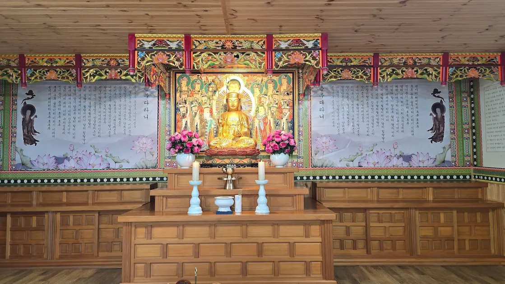

葬儀の場の片隅で、あるいは静かな山寺のお堂で、木魚のような音にのって流れてくるお経を聞いたことはありませんか。

韓国ではそれが「クァンジャジェボサル　ヘンシム　パニャバラミルタシ……」と聞こえます。日本で「かんじーざいぼーさー　ぎょうじんはんにゃーはーらーみーたーじー」と唱えられる、あの一節です。意味は分からなくても、聞いているとなぜか心が静まっていく響き。私にとって般若心経は、長いあいだそんな「音」でした。

韓国でも般若心経は、いちばんよく読まれるお経です。お寺の朝夕のお勤めでも、亡くなった方のための法要でも、必ずといっていいほど唱えられます。日本でも写経や読経でなじみ深いお経だと聞きました。海をへだてた二つの国が、同じ短いお経を声に出して読みながら暮らしてきた。考えてみると、不思議なご縁です。

今日からこのサイトで、般若心経を一句ずつ、私たちの暮らしに照らして読んでいきます。最初の一編として、私がどのようにこの260文字と出会ったのかをお話しします。



## 意味も分からず聞いていた260文字

私が初めて般若心経を聞いたのは、1969年、9歳のときでした。ある山奥の小さな庵で、年老いた女性の信者さんがお経を唱えていたのです。韓国では、お寺に通う年配の女性を敬って「ポサルニム（菩薩さま）」と呼びます。そのおばあさんの声は、子どもの耳にも不思議と心地よく響きました。もちろん当時は、何のお経かも分かりません。あれが般若心経だったと知ったのは、ずっと後のことです。

その後も般若心経は、いつも耳になじんだ音でした。山寺に立ち寄ったとき。家の年長者の「チェ（齋）」に参ったとき。チェは日本の法要にあたる追善の儀式で、韓国では四十九日のあいだに七回営む「四十九齋」がよく知られています。そして弔問に出かけたとき。韓国の弔問は、たいてい病院に併設された葬儀場で、二、三日にわたって行われます。そうした場でいつも、木鐸（モクタク）という木の法具を打つ音とともに、あの一節を聞いてきました。

けれども正直に申し上げると、長いあいだ般若心経は、意味の分からないまま唱える「音」に近いものでした。耳にはなじんでいても、心にはまだ届いていないお経。暗記はできても、意味を説明しようとすると言葉に詰まる。般若心経は、そんな「いちばん近くて、いちばん遠い」お経ではないでしょうか。

## 母を背負って歩いたお坊さん

その260文字が少しずつ心に届きはじめたのは、ひとりのお坊さんとのご縁のおかげです。京畿道抱川（ポチョン）にある小さな庵、大賢庵（テヒョンアム）の住職、大賢（テヒョン）スニムです。「スニム」は、韓国語でお坊さんを敬って呼ぶ言葉です。

初めてスニムを訪ねたのは、私が28歳のときでした。公務員試験を目前に控え、人生でいちばん不安だった時期です。人づてに居場所を探し当て、会いに行きました。それから数十年。スニムは私に仏法を説いてくださる師であり、人生が揺らぐたびに戻って寄りかかれる心の支えでした。

スニムは1959年に生まれ、1990年に出家されました。出家後は大賢庵を守りながら、お母さまをそばでお世話されました。お母さまが亡くなるまでの十年間、外出のたびにお母さまを背負って歩き、毎日お風呂にも入れてさしあげたそうです。

出家とは、世俗の縁を離れることだとよく言われます。けれどもスニムの生き方は、出家がむしろ、いちばん深い縁をいちばん心をこめて大切にする道でもありうることを教えてくれます。お母さまが亡くなると、スニムは極楽往生を願って、六か月のあいだに百万回の礼拝を捧げられました。今も大賢庵に地蔵菩薩をお祀りし、お母さまと、この世を去った人々のための祈りを続けておられます。

地蔵菩薩は、苦しむ人がひとりでも残っているかぎり、自分が仏になるのを後回しにすると誓った菩薩です。『地蔵菩薩本願経』には、地蔵菩薩が前世で亡き母を救うために力を尽くした話が伝わり、韓国では昔から「孝」の菩薩としても敬われてきました。日本では道ばたの「お地蔵さま」として親しまれている、あの菩薩です。



## 言葉より先に、生き方で教わった「般若」

だからでしょうか。私にとってスニムの教えは、言葉より先に、生き方として伝わってきました。お母さまを背負って歩いた背中、百万回ひれ伏しては立ち上がったその姿は、どんなお経の一句よりもはっきりと「般若」、つまり智慧の道を見せてくれました。

スニムから聞いた言葉で、今も心に残っているものがあります。「業障消滅（ごっしょうしょうめつ）」です。今の人生で起こることはすべて、前世から続いてきた業（ごう）のあらわれである。それを消していくのは、毎日くり返す祈りと実践である――。スニムはこの言葉を、ご自身の毎日で示してこられました。

つかめるものは何もないと知りながら、それでも愛を尽くすこと。見送りながらも、その縁を最後まで心をこめてつないでいくこと。般若心経のいう「空」とは、すべてがむなしいという意味ではなく、執着せずに心を尽くす生き方なのかもしれない。私はスニムのそばで、そう学びました。そして般若心経は遠い昔のインドの話ではなく、今日の私たちの話なのだと、少しずつ分かってきたのです。

この連載は、そうして積み重なったご縁から生まれました。スニムが長い修行で汲み上げてこられた教えと、平凡な生活者として生きてきた私が、人生の節目ごとにその教えに照らしてみた経験を、ひとつに編んでいます。お経の意味と教えの土台はスニムに正していただき、それを今日の暮らしにつなぐ話は私が書きました。修行者の目と生活者の目が、一つの場所で出会えたらと願っています。

## なぜ「260文字に込められた人生」なのか

韓国で読まれている版の般若心経は260文字です。日本で広く読まれている版には「遠離一切顛倒夢想（おんりいっさいてんどうむそう）」のように「一切」の二文字が入るため、ふつう262文字と紹介されます。文字数は少し違っても、込められた意味は同じです。この連載では、韓国の読誦本にならって「260文字」と呼ぶことにします。

この短いお経をゆっくり読んでいくと、そこに私たちの人生の曲がり角がすべて入っているように思えてきます。何かにしがみついて苦しむところから始まり、それを手放して恐れのない心に至り、ついには周りの人と一緒に彼岸へ渡ろうと歌う道。それはお経の道であると同時に、私たちみんなが歩いていく人生の道でもあります。

とくに、人生の後半を歩いておられる方を思いながら書いていきます。仕事から退き、体が以前のようにはいかなくなり、親しい人を一人、また一人と見送りながら、「自分は何をつかんで生きてきたのだろう」と問うようになる時期。その問いの前で、般若心経はよき道連れになってくれます。仏教をよく知らなくても、お寺に通っていなくてもかまいません。自分の心を正直にのぞいてみようという気持ちがひとつあれば十分です。

## この連載の読み方

連載は三つの部に分かれています。第1部では、般若心経の全文とその由来、題名の意味をたどりながら、お経と初めてのあいさつを交わします。第2部では、経文を最初から最後まで一句ずつ読み、その意味を暮らしに照らしてみます。第3部では、怒り、心配、心の傷、別れ、老い、死、欲といった、日々ぶつかる問題の前で、260文字をどう取り出して使えるのかを一緒に考えます。各回の終わりには、すぐに試せる「今日の心のお稽古」を一行ずつ添えます。

最初から順に読んでいただいても、今いちばん気がかりなテーマから開いていただいてもかまいません。ただ、ひとつだけお願いがあります。急がずに、一編を読んだら一日ほど、その中の一行を胸に置いて過ごしてみてください。260文字は短いけれど、急いで読む文章ではありません。長く浸すほど味わいの深まるお茶のように、ゆっくり噛みしめたとき、はじめて本当の味を見せてくれます。

私は韓国・江原道の華川（ファチョン）という山あいの町に暮らしています。湖と山に囲まれたこの土地の四季の話も、「韓国の話」のページで折々にお届けします。海の向こうの日本の皆さんと、この260文字の道を一緒に歩けることを、うれしく思います。

## おわりに

短い260文字の中に、一生を渡っていくための智慧が込められています。さあ、その道へ一緒に入っていきましょう。

<strong>今日の一句</strong>

羯諦羯諦 波羅羯諦 
ぎゃーてい ぎゃーてい はーらーぎゃーてい

行こう、行こう、彼岸へ行こう。みんな一緒に渡っていこう。

**今日の心のお稽古**：今日一日のうちに一度、般若心経の最初の言葉「観自在菩薩（かんじざいぼさつ）」を声に出して読んでみましょう。



経典の意味と教義の監修：大賢（テヒョン）スニム（韓国・京畿道抱川 大賢庵 住職）

