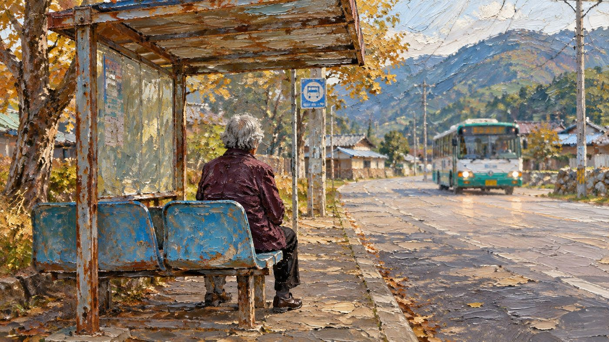

夕食の後片づけを終えて布団に入ったのに、昼間に言われたひと言が何度も頭に浮かんできます。市場で野菜の値段を聞いただけなのに、「買わないなら触らないで」と投げつけるように言った店の人。その場では何も言い返せずに立ち去ったのに、帰り道ずっとその言葉をかみしめていました。横になってもあの顔が浮かび、あのとき言い返せばよかった言葉を、ひとりであれこれ考えてしまいます。

だれにでも、そんな日があります。朝、家を出てから夜に帰るまで、私たちはたくさんの顔に出会います。バス停で一緒にバスを待った人、銀行の窓口の人、病院の待合室で隣に座ったお年寄り、そして家で向かい合う家族。それなのに、たくさんの顔の中で心にいつまでも残るのは、なぜかきつい言葉を投げた人の顔なのです。

この連載は、まさにその人のお話です。今日、私にきつい言葉を投げたあの人。もしあの人が、じつは観音さまだったとしたら、どうでしょう。



## 私を怒らせた人が、どうして観音さまなのか

はじめて聞くと、首をかしげたくなるかもしれません。観音さまといえば、やさしいお顔で蓮の花の上に座っていらっしゃる方です。ぞんざいな口をきいたあの店の人が、どうして観音さまなのでしょう。

韓国語には、ていねいな言葉づかいと「パンマル（반말）」と呼ばれるくだけた言葉づかいが、はっきり分かれています。初対面の年上の人にパンマルを使うのは、たいへん失礼なこととされます。日本語でいえば、初めて会った目上の人に「ため口」をきくような感じです。

また韓国の田舎には、決まった日に立つ「五日市（オイルチャン）」という市場があります。私が暮らす江原道・華川（ファチョン）でも、毎月3と8のつく日（3日・8日・13日・18日・23日・28日）に市が立ちます。冒頭の場面は、そんな市場でのひとこまです。

少し見方を変えると、意味が見えてきます。だれかのきつい言葉に心が傷ついたなら、私はその言葉がどれほど痛いかを、身をもって学んだことになります。頭でしかわかっていなかったことを、胸でわかったのです。あの人は「あなたは人にそんなことをしてはいけないよ」ということを、全身で見せてくれたわけです。

昔の人は、こういう人を「反面教師」と呼びました。悪い手本を見せることで、逆に教えてくれる先生という意味です。日本でもそのまま使われている言葉ですね。聞いていて嫌な気持ちになったなら、その嫌な気持ちこそが教えなのです。

> 「あなたは、そんなふうにしてはいけないよ」
> ── きつい言葉を投げた人が、今日、私に残していったひと言

## あの人は、私の姿を映す鏡だった

その教えは、もう一歩先へ進みます。私が言われて痛かったあの言葉を、もしかして私も、だれかに言ってはいなかったでしょうか。この問いの前に立つと、多くのことが違って見えてきます。

市場のぞんざいな言葉に腹を立てた私が、食堂の店員さんに「ちょっと、水」と言っていた人だったことに気づきます。小言に傷ついた私が、子どもに「そんなこともわからないの？」と言っていた人だったことにも気づきます。きつい言葉を投げたあの人は、結局、私の姿を映してくれる鏡だったのです。

もちろん、観音さまはきつい顔だけでいらっしゃるわけではありません。先にあいさつをしてくれるご近所さん、黙って話を聞いてくれる友だち、雨の日に傘を傾けてくれた見知らぬ学生もいます。きつい人は「してはいけないこと」を、あたたかい人は「するとよいこと」を見せてくれます。顔は違っても、どちらも私を目覚めさせに来てくれた方たちです。



## 観音さまは、バス停にもいらっしゃる

観世音菩薩とは、「世の中の声（音）を観る方」という意味の名を持つ菩薩です。『法華経』の「観世音菩薩普門品（ふもんぼん）」には、観音さまが三十三のお姿に身を変えて人々を救うと説かれています。この章は日本でも『観音経』として広く読まれていますし、三十三の観音霊場をめぐる「西国三十三所」の巡礼も、この「三十三」に由来するといわれます。

注目したいのは、その三十三のお姿の多くが、長者（お金持ち）、役人、家を守る婦人、子どもといった、ごく普通の人の顔だということです。観音さまは、お寺のお堂の中だけにいらっしゃる方ではありません。私たちが毎日行き来する道の上に、毎日すれ違う人の顔の中にいらっしゃるのです。

私が本の題名を『観音さまはバス停にもいらっしゃる』としたのも、そのためです。バス停は、暮らしの中でいちばんありふれた場所です。だれもがそこで待ち、見知らぬ人と並んで立ちます。割り込む人も、席をゆずる人も、荷物を持ってくれる人も、そこにいます。観音さまは、そんなありふれた場所に、ありふれた顔でいらっしゃいます。ただ、私たちが気づかないだけなのです。

## 気づいた人と、通り過ぎた人 ── 義湘（ぎしょう）と元暁（がんぎょう）

今から千三百年あまり前、朝鮮半島の新羅（しらぎ）という国に、二人の高僧がいました。義湘大師と元暁大師です。韓国の古い歴史書『三国遺事』には、二人が東海（日本海）に面した洛山（ナクサン）の海辺へ、観音さまを訪ねて行ったお話が並べて記されています。

この二人の名前は、日本の方にもなじみがあるかもしれません。京都・高山寺に伝わる国宝の絵巻『華厳宗祖師絵伝（華厳縁起）』には、義湘と元暁が主人公として描かれています。新羅の二人の僧は、日本でも長く親しまれてきたのです。

義湘大師は、ひたむきな心で身と心を整えながら待ち続け、ついに観音さまの本当のお姿に出会いました。いっぽう元暁大師は、その道の途中で観音さまに出会いながら、気づかずに通り過ぎてしまいました。田んぼで稲を刈っていた女性、橋の下で洗濯をしていた女性こそが、観音さまだったというのにです。歴史に名を残すほど知恵のある僧でさえ、ふだんの顔でいらっしゃった観音さまに気づけなかったのです。

この二つのお話が、この連載全体をつらぬく一本の柱です。私たちは毎日、義湘にもなれるし、元暁にもなりえます。今日きつい言葉を投げたあの人の前で、私はどちらだったでしょうか。二人の僧のお話は、これからの記事でくわしくお伝えします。

## この連載の読み方と、短いひと言

これからこのコーナーでは、言葉でやって来る観音さま（ため口、小言、陰口、口うるささ）、行いでやって来る観音さま（割り込み、クラクション、約束を破ること）、家族の中の観音さま、見知らぬ人の顔でやって来る観音さま、そしてあたたかい顔でやって来る観音さまに、順番に出会っていきます。十七歳の高校生から八十歳を過ぎたおばあさんまで、年齢も立場もさまざまな人たちのお話です。

一日一編ずつ、ゆっくり読んでみてください。順番どおりでなくてもかまいません。今日、心に引っかかることがあれば、それに似たお話から開いてみてもよいでしょう。仏教の信者でなくても大丈夫です。「観音さま」という名前になじみがなければ、「私を目覚めさせに来た人」と読みかえてもかまいません。

ここで、私自身の話をひとつさせてください。

お酒を飲むと、決まって私に電話をかけてくる人がいます。そして、私があまり好きではない歌を「聴いてくれ」と、何度も頼み込むのです。正直に言えば、少し困ってしまいます。けれども、あとで考えるとこう思うのです。こういうことを人にすれば、相手は迷惑に感じるものだ──。それを身をもって教えてくれるあの人は、私にとっての観音さまなのだと。

ですから、きつい言葉を聞いた日や、困ったことをされた日には、心の中でそっと唱えてみてください。この短いひと言が、怒りを教えに変える最初の一歩になります。

> 「観音さま。今日もまた、ひとつ学びました」

## もう一度、あの人を思い浮かべて

それでは最後に、今日きつい言葉を投げたあの人の顔を、もう一度思い浮かべてみてください。さっきまで憎らしいだけだったあの顔が、少し違って見えてきたでしょうか。あの人にも、あの人なりのつらい一日があったのかもしれません。そしてあの人は、私が今日だれかに言ってはいけない言葉を、先に見せてくれたのかもしれません。

あの人は、今日あなたのもとにやって来た観音さまでした。バス停で、市場の路地で、食卓の向かい側で。さあ、その観音さまたちに会いに、一緒に出かけてみましょう。

> **今日の心のひと言**
> 今日、私にきつい言葉を投げたあの人も、観音さまでした。


