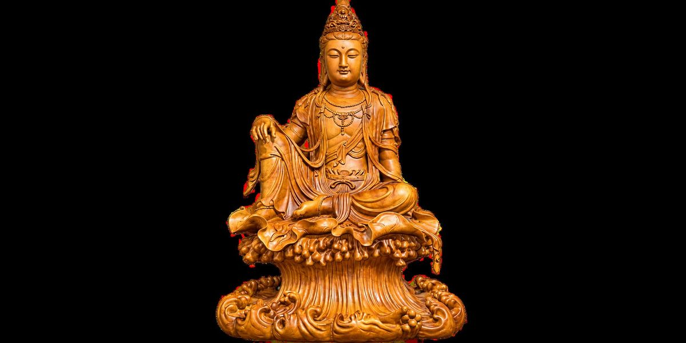

韓国のお年寄りは、びっくりすると、まずこの言葉を口にしました。

「アイゴー、クァンセウムボサル（ああ、観世音菩薩）」

風で味噌がめのふたが飛ばされても、子どもが縁側から転げ落ちそうになっても、「アイゴー、観世音菩薩」。お寺に通っていない人でも、この言葉は知っています。信心があるかどうかにかかわらず、暮らしの中で自然に出てくる口ぐせなのです。

今でもそうです。腰が痛いときも、足を引きずって歩く子犬を見かけたときも、おばあさんたちは「ナム・クァンセウムボサル（南無観世音菩薩）」とつぶやきます。それほど観音さまの名前は、私たちの暮らしのすぐそばにありました。

こんな方もいました。七十歳を過ぎたおばあさんで、一生、市場の片すみに座って野菜を売っていた方です。お客さんが値切りに値切って声を荒らげても、おばあさんはただ「観世音菩薩」と言って笑っていたそうです。どうしてそうするのかと聞かれると、こう答えたといいます。

> 「そうすると、こっちの気持ちが楽になるんだよ。あの人だって、よっぽどのことがあるんだろうさ」

ところが、いざ「観音さまって、どんな方？」と聞かれると、すっと答えるのは難しいものです。仏さまなのか、菩薩さまなのか。どんなことをなさる方なのか。はっきり知っている人は、あまり多くありません。これから毎日出会う観音さまのお話をする前に、まずはこの方がどなたなのかを知っておきましょう。



## 世の中の声を「観る」方 ── 観世音と観自在

「観世音」という名前を一字ずつほどいてみると、意味がはっきりします。「観」は見ること、「世音」は世の中の声（音）のこと。世の中の声を観る方、それが観世音菩薩です。

声は「聞く」ものなのに、なぜ「観る」と言ったのでしょう。耳で聞くだけで終わらず、その声を出している人の心の中までよく見てくださる、ということです。泣き声の裏にかくれた不安、怒った声の裏にかくれた悲しさまで見てくださる方なのです。

この名前の意味は、『法華経』の「観世音菩薩普門品（ふもんぼん）」に出てきます。日本ではこの章だけを取り出して『観音経』と呼び、広く読まれていますね。無尽意菩薩（むじんにぼさつ）が「観世音菩薩は、どういうわけで観世音と呼ばれるのですか」とたずねると、お釈迦さまはこう答えられます。

善男子、若有無量百千万億衆生、受諸苦悩、聞是観世音菩薩、一心称名、観世音菩薩即時観其音声、皆得解脱。

善男子（ぜんなんし）よ、もし無量百千万億の衆生ありて、もろもろの苦悩を受けんに、この観世音菩薩を聞きて、一心に名を称（しょう）せば、観世音菩薩、即時にその音声を観じて、みな解脱することを得しめん。

【やさしい訳】数えきれないほどたくさんの人々が、さまざまな苦しみを受けているとき、この観世音菩薩の名を聞いて、心をひとつにしてその名を呼べば、観世音菩薩はすぐにその声を聞きとどけ、みな苦しみから救われるでしょう。

── 『法華経』観世音菩薩普門品

苦しんでいる人が心をこめて呼べば、その声を聞きもらさず、よく見て救ってくださる、というお言葉です。韓国のお年寄りが、驚くたびに観音さまの名を呼んできたのも、この信仰から生まれたのでしょう。

観音さまには、別の呼び名もあります。『般若心経』は「観自在菩薩（かんじざいぼさつ）」という言葉で始まりますね。「何にもとらわれず、自由自在に観る方」という意味です。毎朝『般若心経』を唱えている方なら、あの最初の「観自在菩薩」こそが観音さまだと知ると、うれしくなるのではないでしょうか。

同じ方なのに名前が違うのは、訳した人が違うからです。『法華経』を訳した鳩摩羅什（くまらじゅう）は「観世音」と訳し、『般若心経』を訳した玄奘（げんじょう）は「観自在」と訳しました。

世の中の声をよく見てくださる方、そして、とらわれずに観る方。二つの名前を並べてみると、観音さまがどんな方なのか、少しはっきりしてきます。人の痛みをえり好みせず、かたよりなく、ありのままに見てくださる方なのです。



## じつは、すでに仏であった方 ── 正法明如来

観音さまについて、あまり知られていないお話がひとつあります。観音さまは、はるか昔に、すでに仏になっていた方だというのです。

「菩薩」は「菩提薩埵（ぼだいさった）」を縮めた言葉で、悟りを求めながら、ほかの人も一緒に救おうとする人のことです。ふつうは「仏になる前の段階」と考えられています。ですから、仏になった方を菩薩と呼ぶのは、少し不思議に聞こえるかもしれません。

このお話は『千手千眼観世音菩薩大悲心陀羅尼経（せんじゅせんげんかんぜおんぼさつだいひしんだらにきょう）』に出てきます。韓国のお寺で毎日唱えられている「千手経（チョンスギョン）」のもとになったお経です。この中で、お釈迦さまは観音さまについてこう語っておられます。

此観世音菩薩、不可思議威神之力、已於過去無量劫中、已作仏竟、号正法明如来。大悲願力、為欲発起一切菩薩、安楽成熟諸衆生故、現作菩薩。

この観世音菩薩は、不可思議の威神の力あり。すでに過去無量劫（むりょうこう）の中において、すでに仏と作（な）りおわりて、正法明如来（しょうぼうみょうにょらい）と号す。大悲の願力をもって、一切の菩薩を発起し、もろもろの衆生を安楽成熟せしめんと欲するがための故に、現じて菩薩と作る。

【やさしい訳】この観世音菩薩は、はかり知れない力を持っている。はるか遠い昔に、すでに仏となり、その名を正法明如来といった。けれども、人々の苦しみを深く悲しむ大きな願いから、すべての菩薩の心を呼び起こし、人々を安らかにし、育てていくために、菩薩の姿となって現れたのである。

── 『千手千眼観世音菩薩大悲心陀羅尼経』

正法明如来とは、「正しい教えを明るく照らした如来」という意味です。如来は仏さまを敬って呼ぶ名前ですね。観音さまは、すでに仏でありながら、自ら菩薩の座へと降りてこられたのです。

高い座をことわって、低いところへ降りてきてくださった方。それが観音さまです。

わが家にお祀りしている観音さま

では、仏になったのなら、そのままその座にいてもよかったはずなのに、なぜ観音さまは、もう一度菩薩の姿で私たちのところへ来られたのでしょうか。そのわけは、後編でお話しします。

> **今日の心のひと言**
> 観音さまは、私たちの声だけでなく、その声の奥にある心まで観てくださる方です。


