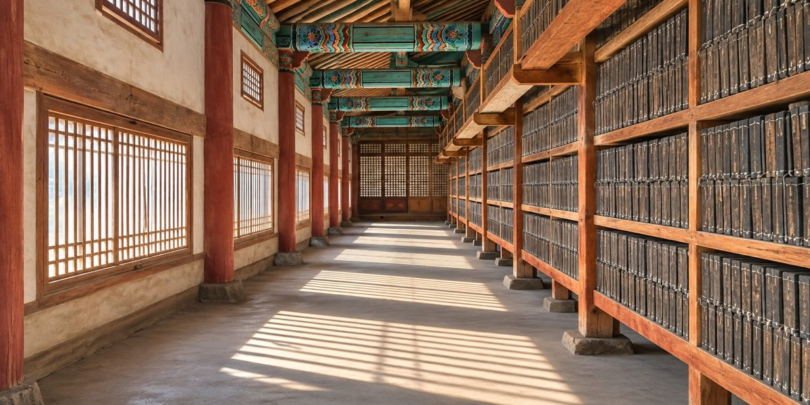

韓国のお寺では、朝の三時ごろ、まだ真っ暗なうちに一日が始まります。「道場釈（トリャンソク）」といって、お坊さんが木鐸（モクタク）を打ちながら境内をめぐり、眠っている山寺を起こします。続いて朝のお勤めが始まり、そこで必ずといっていいほど唱えられるのが般若心経です。

私も一度、師である大賢（テヒョン）スニムの庵、大賢庵に一晩泊めていただいたことがあります。スニムのあとについて、朝のお勤めと夕方のお勤めに加わりました。暗い法堂に響く読経の声は、今も耳に残っています。

前回の前編では、インドで花開いた般若の智慧が、砂漠を越えた玄奘三蔵の手を経て、260文字の漢文のお経になるまでをたどりました。今回の後編では、そのお経が海を渡って韓国に根づき、今朝の山寺のお勤めの声になるまでの道を歩いてみます。日本へ渡った道も、少しのぞいてみましょう。



## 新羅のお坊さんが唐で書いた解説書

玄奘の訳は、ほどなく朝鮮半島にも伝わりました。とくに注目したいのが、新羅の円測（えんじき、韓国語でウォンチュク）というお坊さんです。円測は若くして唐に渡り、生涯をかけて学問と修行に励みました。玄奘が翻訳を率いていたころ、長安で共に活動していた人です。

円測が残した般若心経の注釈書が『般若波羅蜜多心経賛』です。新羅のお坊さんが書いたこの解説書は今も伝わっており、般若心経を、心の働きを深く見つめる「唯識（ゆいしき）」の立場から読み解いた、独特の書物として評価されています。異国の地で、生涯このお経の意味を書き記したお坊さんがいたのです。

## 八万大蔵経、そしてハングルの般若心経

高麗の時代に彫られた「八万大蔵経」にも、般若心経が収められています。八万大蔵経は、13世紀、モンゴルの侵攻という国の大きな困難の中で、仏の力で国を守ろうと、人々の心をひとつにして木の版に彫り上げた大蔵経です。版木が八万枚を超えることからこの名がつきました。今は韓国南部・陜川（ハプチョン）の海印寺（ヘインサ）に納められ、版木を収めた建物「蔵経板殿」はユネスコの世界遺産に、版木そのものは「世界の記憶」に登録されています。その膨大な版木の中に、この短いお経も一つの場所を占めているのです。



古いお寺を訪ねると、私はいつも身の引き締まる思いがします。宗教の違う人が、思わず手を合わせている姿を見たこともあります。それほどまでに、古いお寺には厳かさと静けさがしみこんでいるのでしょう。

朝鮮の時代に入ると、般若心経は韓国の言葉の衣をまといます。1464年、お経の翻訳と出版を担った役所「刊経都監」が、『般若波羅蜜多心経諺解』を刊行しました。「諺解（げんかい）」とは、漢文をハングルで解き明かしたという意味です。ハングル（訓民正音）が公布されてから、まだ二十年もたっていないころでした。新しく作った文字でこのお経を解き、民に伝えようとしたのです。

そして今日、般若心経は、韓国のお寺の朝夕のお勤め、法会、追善の儀式で、ほとんど欠かさず読まれるお経になりました。韓国最大の仏教宗派である大韓仏教曹渓宗は、漢文のお経とともに、やさしいハングルに訳した般若心経も用意しています。それでも韓国のお寺では、今も玄奘の漢文のお経を、音のまま唱える伝統がしっかりと受け継がれています。意味の分かりやすい韓国語のお経と、長い年月口から口へ伝えられてきた漢文のお経が、並んで生きているのです。

## 海を渡って日本へ

般若心経は、日本でも長く大切にされてきました。真言宗を開いた空海（弘法大師）は、般若心経を解説した『般若心経秘鍵』を残しています。京都の大覚寺には、818年に疫病がはやったとき、嵯峨天皇が空海のすすめで般若心経を自ら書き写したという話が伝わり、その写経は60年に一度だけ開かれる勅封の般若心経として守られているそうです。大覚寺は今も写経の根本道場として知られています。

韓国では声に出して読む「読経」として、日本では筆で書き写す「写経」として、より親しまれているという違いはあります。それでも二つの国の人々は、同じ玄奘の260文字をよりどころにして、千年以上、心をなぐさめてきました。

## 260文字が渡ってきた道、私の心が渡っていく道

この長い旅をふり返ると、一つのことに気づきます。般若心経は、一度もひとりで歩いてきたことがない、ということです。お経を最初にまとめた名もない修行者たち。命がけで砂漠を越えたお坊さん。異国で生涯その意味を書き記した新羅のお坊さん。版木の一枚一枚に刃を入れた高麗の職人たち。新しい文字でお経を訳した朝鮮の学者たち。そして今日も朝のお勤めでこのお経を読むお坊さんと信者たち。その数えきれない手を経て、260文字は今、あなたの前にあります。

般若心経は、その渡りを「向こう岸へ行く」と表します。苦しみのあるこちらの岸から、やすらぎのある向こう岸へ行くことです。千三百年以上も前、砂漠の真ん中でこのお経を唱えたお坊さんの恐れと、今夜眠れずにいる私たちの心配は、それほど違わないのかもしれません。

前編でお話ししたとおり、私自身も今、選挙に関わる法律の件で、裁判にかけられるかもしれないという砂漠の中にいます。それでも私は、般若心経を読むうちに、自分の業（ごう）が少しずつ溶けていくと信じています。とくに「ぎゃーてい　ぎゃーてい　はーらーぎゃーてい」――韓国の音で「アジェアジェ　パラアジェ……モジ　サバハ」を、何度も何度もくり返しています。玄奘がこのお経をよりどころに砂漠を越えたのなら、私たちもこのお経をよりどころに、今日の砂漠を越えていけるのではないでしょうか。

## おわりに

千年を渡ってきた260文字。今度は、私の心を渡らせてくれる番です。次回は、『摩訶般若波羅蜜多心経』という題名一行に込められた意味を、一字ずつ読み解いていきます。

<strong>今日の一句</strong>

三世諸佛 依般若波羅蜜多故 得阿耨多羅三藐三菩提 
さんぜしょぶつ えはんにゃはらみったこ とくあのくたらさんみゃくさんぼだい

過去・現在・未来のすべての仏さまも、智慧の完成をよりどころとして、この上なく正しい悟りを得られました。

**今日の心のお稽古**：今、目の前にある困りごとに「私の砂漠」と名前をつけて、一行で書き留めておきましょう。そして、初めて般若心経を聞かせてくれた人を思い浮かべ、心の中で「ありがとう」と伝えてみてください。



経典の意味と教義の監修：大賢（テヒョン）スニム（韓国・京畿道抱川 大賢庵 住職）

