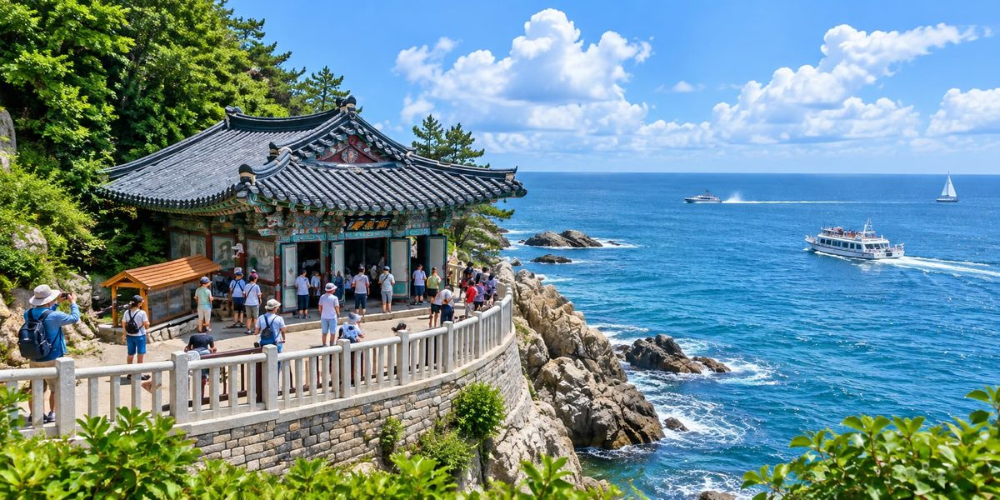

千三百年あまり前、朝鮮半島の新羅（しらぎ）の国。東の海辺の、ある早朝を思い浮かべてみてください。

夜のあいだ静かだった海が、日の出のころになると、また波を打ち寄せはじめます。黒い岩の崖の下には、波が出入りする深い洞窟がひとつあります。その前に、ひとりの僧が座っています。海風に袈裟のすそがはためいても、僧は身じろぎもしません。

その僧が、義湘大師（ぎしょうだいし、625〜702）です。大師は、観音さまに会うためにここへ来ていました。だれかに命じられたわけでも、会えるという約束があったわけでもありません。「この海辺の洞窟に観音さまがいらっしゃる」という言葉ひとつを信じて、訪ねてきたのです。

私たちにも、そんなときがあります。何の保証もないのに、「それでも、行ってみよう」と歩き出すときです。今日は、そうして歩き出し、ついに観音さまに出会った、ひとりの僧のお話をたどってみましょう。



## 遠い道を歩いてきた人 ── 義湘大師と華厳経

このお話は、高麗時代の僧・一然（いちねん）がまとめた歴史書『三国遺事（さんごくいじ）』の巻三「洛山二大聖 観音・正趣・調信」に記されています。洛山（ナクサン）にゆかりのある二人の聖者、観音菩薩と正趣菩薩、そして調信という人のお話、という意味です。

義湘大師は若いころ、仏の教えをもっと深く学ぼうと、海を渡って唐の国へ行きました。そこで智儼（ちごん）という高僧のもとで『華厳経（けごんきょう）』を学びます。この世のすべては網の目のように互いにつながっている、と説く大きなお経です。新羅に戻った大師は浮石寺（プソクサ）を開き、韓国の華厳宗の初祖となりました。

日本で『華厳経』といえば、奈良・東大寺の大仏さまを思い浮かべる方が多いでしょう。東大寺は華厳宗の大本山です。義湘大師は、その同じ『華厳経』を朝鮮半島に根づかせた方なのです。また、前の記事でご紹介した京都・高山寺の国宝の絵巻『華厳宗祖師絵伝（華厳縁起）』に描かれている「義湘」も、まさにこの方です。

『華厳経』の「入法界品（にゅうほっかいぼん）」には、善財童子（ぜんざいどうじ）という若い求道者が、師を訪ねて旅をするお話があります。その旅の途中で、観音さまをお訪ねする場面が出てきます。観音さまのおられる場所は、海辺の山「補陀落迦（ふだらか）」だと説かれています。『華厳経』を深く学んだ義湘大師も、善財童子のように、観音さまにじかにお会いしたいと願ったことでしょう。



## 「洛山」という名前 ── 海辺におられる白衣の観音さま

『三国遺事』は、まず、その場所を「洛山」と呼ぶようになったわけから説明しています。

蓋西域寶陀洛伽山、此云小白華、乃白衣大士眞身住處、故借此名之。

けだし西域に宝陀洛伽山（ほだらかさん）あり。ここには小白華（しょうびゃっけ）という。すなわち白衣大士（びゃくえだいし）の真身の住する処なり。ゆえにこの名を借りて、これに名づく。

【やさしい訳】インドに補陀落迦山という山があり、こちらの言葉では「小さな白い花」という意味である。白い衣をまとった大菩薩の本当のお姿がおられる所なので、その名前を借りてきたのだ。

── 『三国遺事』巻三 塔像「洛山二大聖 観音・正趣・調信」

白衣大士とは、白い衣をまとった観音さまを敬って呼ぶ名前です。補陀落迦の「洛」の字をとって「洛山」と名づけました。今の韓国・江原道（カンウォンド）襄陽（ヤンヤン）の海辺、洛山寺（ナクサンサ）があるところです。

日本の方にとっても、「補陀落（ふだらく）」はなじみのある言葉ではないでしょうか。和歌山・熊野那智の補陀洛山寺や、海のかなたの補陀落浄土をめざして小舟で船出したという「補陀落渡海」のお話が伝わっています。白い衣の観音さまは、日本では「白衣観音（びゃくえかんのん）」と呼ばれていますね。韓国でも日本でも、人々は「観音さまは海辺におられる」と信じてきたのです。

ここで、その意味を少し味わってみましょう。観音さまのおられる場所は、高い天の宮殿ではありませんでした。波の打ち寄せる海辺、人が暮らす土地のはずれでした。観音さまは、はじめから人のそばにいようとなさる方だったのです。

洛山寺の紅蓮庵（ホンニョナム）。義湘大師が観音さまに出会ったと伝わる海辺の洞窟の上に建っています

私も、2019年の10月に、洛山寺のテンプルステイに参加したことがあります。テンプルステイとは、韓国のお寺に泊まって、お坊さんと同じように朝夕のお勤めや食事、瞑想などを体験できる制度です。

そのころ私は、心がとても重くなる出来事を抱えていました。じつを言えば、帰ってきてからも、その悩みがすっかり消えたわけではありません。それでも、波の音を聞きながらお寺で過ごしたあの数日のあと、心の中に確かな静けさが訪れたことは、今でもはっきり覚えています。千三百年前に義湘大師が座っていたあの海辺は、今も、重い心を抱えた人を静かに迎えてくれる場所なのだと思います。

> **今日の心のひと言**
> 観音さまは高い宮殿ではなく、波の打ち寄せる海辺、人のそばにおられます。

では、義湘大師は、どのようにして観音さまに出会ったのでしょうか。その続きは後編でお話しします。


