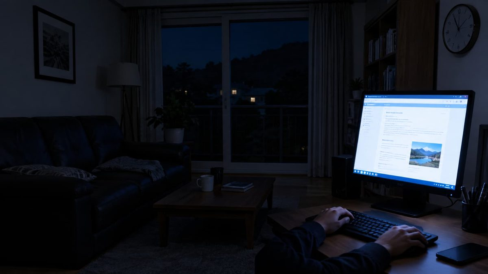
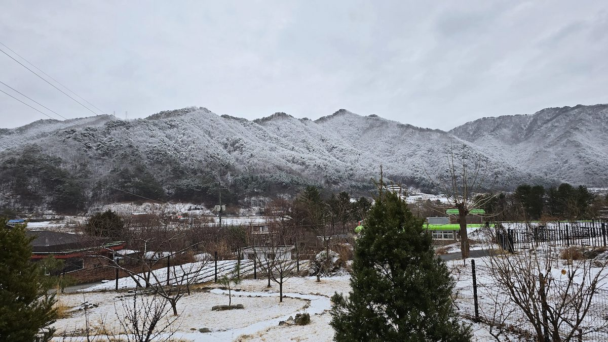

2025年の秋のある朝、携帯電話が鳴りました。訃報でした。

画面に表示された名前は、小学校をともに過ごした友人のものでした。子どものころから30代までは、何かにつけて顔を合わせていた仲です。その後いつの間にか連絡が途絶え、50代になってから久しぶりに再会しました。数か月前の集まりでも「俺たちの年になったら、健康がいちばんだな」と言いながら、杯を合わせたばかりでした。

韓国では、誰かが亡くなると、家族が携帯電話のメッセージで訃報を知らせるのがごく普通です。葬儀はたいてい病院に併設された葬儀場で三日間行われ、知らせを受けた人はその間に駆けつけて、遺影の前で拝礼し、遺族を慰めます。これを「弔問（ちょうもん）」と呼びます。

60歳を過ぎてから、この訃報のメッセージがめっきり増えました。以前は友人のご両親の名前が書かれていたものですが、今は友人本人の名前が届きます。

弔問から帰った夜、私はなかなか寝つけませんでした。明かりを消して横になると、考えが次々に浮かんできます。次は誰だろう。そして、いつかは私も。死への不安は、こんなふうに何の前触れもなく、夜中にやってきました。



## いちばん賢い機械に尋ねた、ひと言

そのころ私は、AIとGitHub（ホームページを作るためのサービス）を学んでいました。60歳を過ぎてから始めた勉強です。はじめは文章を整えたり資料を探したりするのに使っていたAIが、いつの間にか、夜更けにあれこれ話しかける相手になっていました。

その夜、私は居間のパソコンをつけ、入力欄に一行だけ書きました。

> 人は、死んだらどうなるのか。

本当のことを言えば、私が聞きたかったのは医学や科学の説明ではありませんでした。前世は本当にあるのか。来世はあるのか。その答えを、AIがはっきりと言い切ってくれることを、心のどこかで期待していたのです。

AIは誠実に答えてくれました。科学では、脳が止まれば意識も止まると考えられていること。仏教では、業（ごう）の流れが次の生へと続くと教えていること。キリスト教では、復活と永遠のいのちが語られていること。死の淵から戻ってきた人たちの臨死体験や、前世を覚えているという子どもたちの話も、順を追って説明してくれました。

人類が何千年もかけて積み重ねてきた死についての知恵、死後の世界をめぐるさまざまな考えが、わずか数分で画面を埋めていきました。

## それで、私は何を信じるのか

ところが、不思議なことが起きました。あれほど多くのことを知ったのに、心は少しも軽くならなかったのです。

画面を消し、暗い居間に座っていると、胸の奥に一つの問いが、かえってくっきりと残りました。

> それで、私は何を信じるのか。

世界でいちばん多くのことを知っている機械も、この問いには答えてくれませんでした。それは知識の問題ではなかったからです。前世も来世も、AIは「こういう考え方があります」と教えてはくれても、「ある」とも「ない」とも言い切ってはくれませんでした。

親を見送り、友の遺影の前に立ち、明け方三時にわけもなく目が覚めたことのある人だけが、自分で探さなければならない答え。情報は外から手に入れることができても、心の安らぎは結局、自分の内側で見つけるしかない。その夜、私はそのことに気づきました。

この連載は、あの夜から始まります。



## 誰も教えてくれなかった「死」

もしかすると、あなたも今、こんな時間を過ごしているかもしれません。

健康診断の結果に書かれた「要再検査」の一行を前に、何日も眠れなかったとき。介護施設の面会室で、自分のことがわからなくなった母の手を握っているとき。連れ合いに先立たれ、ひとりで用意した食卓についたとき。名刺がなくなったあと、鏡の中の自分に「これから私は、何のために生きるのだろう」と問いかけたとき。

そのすべての瞬間の奥には、口に出せなかった問いが一つあったはずです。私は死が怖い。けれど、何が怖いのかさえ、よくわからない。

私たちはその問いを、誰からも教わりませんでした。学校は計算や歴史を教え、職場は仕事のやり方を教えてくれましたが、死をどう見つめ、どう備えればよいのかは、誰も教えてくれませんでした。大人の前で「死ぬ」という言葉を口にすれば叱られ、私たちは一生、その問いを戸口の外に立たせたまま生きてきたのです。

日本では、人生の終わりに向けて前もって備えることを「終活」と呼び、広く語られていると聞きます。韓国でも日本でも、その客人が戸を叩きはじめた世代が増えているのでしょう。

## 私は先生ではありません

はじめにお断りしておきます。私は死を研究する学者でも、宗教家でも、医師でもありません。

1961年、韓国・江原道（カンウォンド）華川（ファチョン）の山あいで、火田民（かでんみん：山の斜面を焼いて畑を開いた人々）の息子として生まれました。30年間地方公務員として働き、いまは故郷にあるパロ湖安保展示館で、この土地の歴史を語り伝えながら暮らしている、ごく普通の人間です。そして60歳を過ぎてから、AIに死について尋ねた人間です。

ですから、この連載は何かを教えるための文章ではありません。あなたと同じような年齢で、同じような夜を過ごし、同じ問いに先に向き合ってきた者の記録です。その道のりで、私が何に慰められ、何に首をかしげ、最後に何をつかんだのかを、正直にお話ししたいと思います。

## 見知らぬ二人の案内人 ── ラムサとマイケル・ニュートン

この道のりで、私は見知らぬ二人の案内人に出会いました。

一人は、3万5千年前に生きた戦士だとされる「ラムサ」です。アメリカのある主婦が、ある日自宅の台所に現れた彼に出会い、それ以来その教えを伝えていると主張しています。ラムサは語ります。あなたは本来、神聖な存在であり、死とは体という衣を脱ぐことにすぎない、と。そして死後には、罰を下す裁きの代わりに、光の中で自分がしてきたすべてのことを、相手の立場からもう一度味わうのだ、と。

もう一人は、アメリカの催眠療法士マイケル・ニュートンです。彼は多くの人を深い催眠へと導き、その人たちが語った「生と生のあいだ」の記憶を本にまとめました。彼のクライアントたちは語ります。死の瞬間には、先に旅立った懐かしい人たちが迎えに来てくれる。いまそばにいる家族は、長い時間をかけてともに学んできた魂の仲間かもしれない。そして私たちは、今回の人生を自分で選んでやって来たのだ、と。

初めて聞くと、首をかしげたくなる話でしょう。私もそうでした。ですから、先にお約束しておきます。この連載は、あなたに彼らを信じるよう勧めるものではありません。チャネリングという主張も、催眠の中の記憶も、科学で確かめられたものではありません。批判の声も隠さずにご紹介します。

それでも私が二人を案内人に選んだのは、その話が事実であってもなくても、多くの人を恐れの川の向こう岸へと運んできたからです。そして驚いたことに、まったく別の道からやって来た二人の話は、私たちになじみ深い仏教の古い教えと、同じところを指していました。一つのものの見方として、どうぞ気楽に耳を傾けてください。

## 死を学ぶ理由 ── この連載がお届けできるもの

この連載は、死後の世界に何があるのか、確かな答えをお渡しするものではありません。そんな答えを約束する文章があれば、疑ってかまいません。その代わりに、三つのことをお届けしたいと思います。

一つ目は、漠然とした死への不安に名前をつける方法です。正体のわからない恐れは大きく暗いものですが、名前のついた恐れとは、向かい合って話すことができます。

二つ目は、人類がこの問いを前に抱いてきたさまざまな考えと、二人の案内人の話を一か所で見比べ、何を抱え、何を手放すのかを自分で選んでいく時間です。

三つ目は、いちばん大切なこと。今日、何をするかです。子どもに言えなかった言葉、連れ合いにすまなかったこと、手遅れになる前に会いに行くべき人、許せなかった人、そして残りの10年の計画まで。毎回、記事の最後に「今日できる、ひとつのこと」を書いておきます。

この本を書いているあいだに、私には思いがけないことが起こりました。死を長く見つめるほど、かえって一日一日がくっきりしてきたのです。朝のコーヒーの味が、窓の外の山の色が、家族の声が、以前よりも鮮やかに感じられるようになりました。

なかでもいちばん大きな変化は、心の中にありました。私には、一生かたきのまま終わるだろうと思っていた人が二人いました。その二人の讒言（ざんげん）によって、私は30年勤めた公務員の職を追われたのです。けれど死について学ぶうちに、私はその二人を許そうと思うようになりました。その思いは、今も変わっていません。

それだけではありません。以前は、政治的な考え方が違うというだけで遠ざけていた人がいました。今はそういう人と顔を合わせても、気まずさを感じなくなりました。死を学ぶことが、生きることを照らす灯りになる。私はそれを、身をもって知りました。

> 死を学ぶのは、死ぬためではなく、残りの人生をよりよく生きるためです。

## 今日できる、ひとつのこと

静かな時間に紙を一枚取り出して、こう書いてみてください。

**「私は、死の何が怖いのだろう」**

答えは一行でもかまいませんし、「まだわからない」と書いてもかまいません。名前をつけた瞬間、恐れは少しだけ小さくなります。その紙は捨てずに、取っておいてください。この連載を読み終えたあとでもう一度取り出してみると、あなたの答えがどう変わったのかがわかるはずです。

あの夜、AIが答えてくれなかった問いへの私の答えは、この連載の最後の回に書いておきます。さあ、ご一緒に、その道をゆっくり歩いてまいりましょう。


