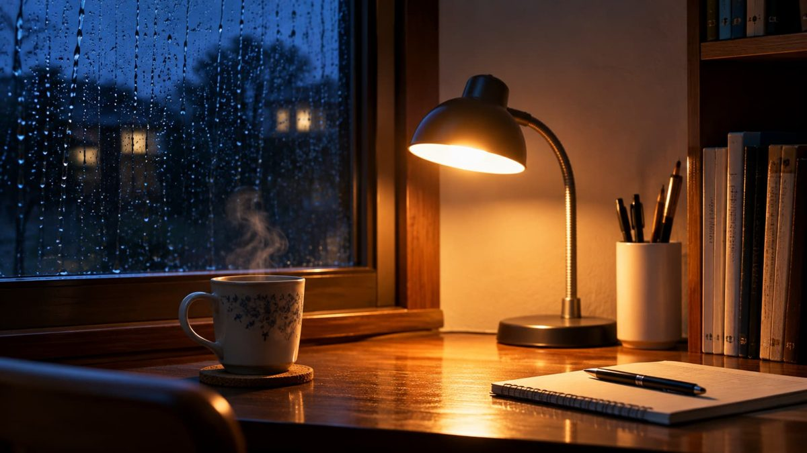

携帯電話に訃報のメッセージが届くことが、めっきり増えました。

以前は、たいてい友人のご両親の知らせでした。「○○○ 父親の喪」という文面を見ると、まずカレンダーを確かめ、弔慰金の封筒を用意したものです。韓国では葬儀場へ行くとき、白い封筒にお金を入れて遺族に手渡します。これを「弔慰金（チョイグム）」といい、日本の香典とよく似た習わしです。

けれど、このごろは違います。訃報のメッセージには、友人本人の名前が書かれています。

## 葬儀場に流れた、短い沈黙

先日訪ねた葬儀場で、私は遺影をしばらく見つめていました。写真の中の顔は、私と同じ年に生まれた人でした。

韓国の葬儀場では、弔問客にユッケジャン（牛肉とワラビを入れた辛いスープ）とご飯をふるまいます。ユッケジャンの器を前に輪になって座った同級生たちは、努めて昔話を持ち出しました。誰かの家の栗の木から栗をもいで叱られたこと、冬の田んぼでそりに乗ったこと。

不思議なことに、亡くなった人の悪口を言う人は一人もいません。みんなが記憶を総動員して、あの人がしてくれたよいことばかりを語るのです。

そのうち誰かが「さて、次は誰の番かな」と笑いました。つられて笑う人はいませんでした。ある人は意味もなく空いた杯を満たし、ある人は携帯電話をのぞき込みました。その短い沈黙の中に、私たちみんなの本音が詰まっていました。

帰りの夜道で、私は自分に問いかけました。私は死が怖いのか。怖いとすれば、いったい何が怖いのか。



## 私たちは「死を口にしない方法」から学んだ

私たちの世代は、死を口にしない方法から学びました。大人の前で「死ぬ」という言葉を出すと、「縁起でもない」と叱られました。建物には4階の代わりに「F階」があり、病室の番号からも4という数字はなかなか見つかりませんでした。韓国語でも「四（サ）」と「死（サ）」は同じ音だからです。

日本でも「四（し）」と「死（し）」が同じ音なので、4を避けるところがあると聞きます。二つの国の人々は、死を遠ざける心まで似ているのですね。

そうやって60年あまり生きてきました。学校は計算や歴史を教え、職場は仕事のやり方を教えてくれました。けれど、死をどう見つめ、どう備えればよいのかは、誰も教えてくれませんでした。親を見送るときでさえ、葬儀の手順に追われるばかりで、死そのものをじっと見つめる余裕はありませんでした。

ですから、死を思うと不安になるのは、ある意味で当然のことです。一度も入ったことのない部屋は、実際よりも広く、暗く感じられるものです。

この連載の第一歩は、その部屋に小さな明かりをひとつ灯すことです。恐れを無理に追い払おうというのではありません。自分が何を恐れているのかを、まずまっすぐに見てみようというのです。



## 恐れの「4つの顔」

漠然としていた恐れをひとつずつ分けて眺めてみると、その中から4つの顔が現れました。

### 1. わからないという恐れ

死の向こうから戻ってきて、そこがどんな所なのかをはっきり教えてくれた人はいません。子どものころ、私たちは暗闇そのものよりも、暗闇の中に何があるのかわからないことが怖くて、明かりを消せませんでした。

病院で検査結果を待つ数日間が、結果を聞く瞬間よりもつらいのと同じです。死は、人生の終わりに置かれた、いちばん大きな「わからないこと」なのです。

### 2. 死にゆく過程への恐れ

よく考えてみると、私たちが本当に恐れているのは、息が止まる瞬間よりも、その手前の時間です。病床で長く患うこと。自分の体を思うように動かせなくなること。誰かの手に身をゆだねること。そして何より、子どもたちの重荷になること。

「眠るように逝きたい」という言葉は、私たちの年代の人がいちばんよく口にする願いになりました。

### 3. 別れの恐れ

旅立つのは、自分ひとりです。妻を、子どもを、孫を残して行かなければなりません。自分のいない夕食の食卓を思い浮かべると、胸の片隅がふさがるような気がします。

そして、その後ろから静かについてくる思いがあります。あの人たちも、いつか私を忘れてしまうのではないか、という思いです。

### 4. 消えてしまう恐れ

一生かけて積み上げてきた名前も、経験も、記憶も、一瞬でなくなってしまうこと。私だけが覚えている故郷の昔の風景まで、煙のように散ってしまう。その思いは、なかなか受け入れられるものではありません。

世の中は、私がいなくても何事もなかったかのように回っていくでしょう。そのことが寂しく、そして怖いのです。

---

けれど、この4つの顔をくぐり抜けて、いちばん深いところまで降りていくと、最後にもうひとつの恐れが残ります。それは何なのか。（後編）では、その「5つ目の恐れ」と、恐れに名前をつけて今日の行動に変える方法についてお話しします。


