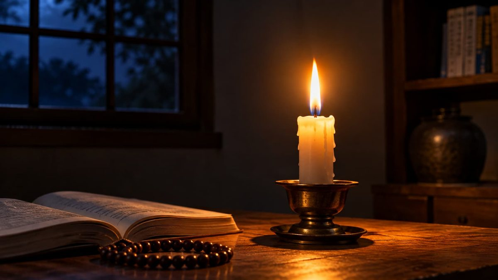

<strong>この回の経文</strong>

照見五蘊皆空 
しょうけんごうんかいくう

体と心をつくる五つのものが、すべて「空」であると、明るく照らして見る。

家庭菜園をされたことのある方なら、よくご存じでしょう。春に唐辛子やサンチュの苗を植えると、数日もしないうちに、どこからか雑草が顔を出します。抜いて振り返ると、また生えてきます。はじめは雑草が憎らしく思えます。自分が植えたわけでもないのに、なぜこんなに伸びてくるのかと、いらいらします。

ところが何年か畑を耕していると、気持ちが少し変わってきます。雑草は憎んでも消えないこと。かわりに、しょっちゅう畑に出て見て回る人の畑はきれいだということが分かってきます。早く気づけば、根が深くなる前に楽に抜けます。畑を守る力は、鍬（くわ）よりも目にあったのです。そして、雑草がどんなに茂っても、畑は畑のままです。雑草は、しばらく伸びては消えていくお客さまにすぎません。

正直に言うと、私も同じ道をたどりました。田舎に戻って暮らしはじめたころは、草取りも心の癒やしだと思って、せっせと励みました。ところが年を重ねるごとに、だんだん面倒になってきたのです。とうとう、広い畑には防草シートを敷いてしまいました。

けれども、心の畑には防草シートを敷くことができません。一日に何度も、寂しさ、いらだち、心配、うらやましさといった心の雑草が生えてきます。憎んで押さえつけても消えません。こまめにのぞいて、早く気づいたとき、心の畑は整っていきます。これが、今日お話しする「心の修行」の出発点です。韓国の仏教では、これを「マウムコンブ（心の勉強）」と呼びます。大げさな修行ではなく、毎日の暮らしの中で自分の心を見つめることです。



## 心を直すのではなく、見ること

「心の修行」と聞くと、何か大がかりな修行を思い浮かべる方が多いでしょう。山奥のお寺で長く座っていなければならないような、怒らない善い人にならなければならないような気がします。それで、始める前から「私なんかが」と尻込みしてしまうこともあります。

けれども、心の修行の第一歩は、心を直すことではなく「見る」ことです。腹が立ったときに、怒りをこらえなさいというのではありません。「ああ、今、私は腹を立てているな」と気づくことです。この小さな気づき一つが、大きな違いを生みます。怒りに巻き込まれていた自分が、怒りを眺める場所へ、一歩下がることができるからです。

たとえば、久しぶりに子どもに電話をかけたのに、「忙しいから」とすぐに切られてしまったとします。寂しい気持ちがぐっとこみ上げてきます。そのままにしておくと、この寂しさはすぐに物語を作りはじめます。「最近、私のことが面倒なんだな」「育てても、何にもならないものだ」。一、二時間もすると、心は手のつけられないほど重くなっています。けれども、寂しさがこみ上げたその瞬間に「ああ、今、寂しいんだな」と気づけば、寂しさは寂しさのままで、もっと大きな物語には広がりません。雑草が根を張る前に見つけたのです。

とはいえ、私自身、まだ「気づく」段階には届いていないと感じています。今も、そうなれるように努めているところです。ただ、意識しようとすること、そこから修行は始まるのだと思っています。

## 灯りのように照らして見る ―「照見」

今回の一句「照見五蘊皆空」の「照見（しょうけん）」が、まさにこの「見ること」を語っています。灯りをかかげて暗い部屋を照らすように、智慧の光で自分の体と心を明るく照らして見る、という意味です。観自在菩薩が苦しみを渡れたのも、何かをつかんだり直したりしたからではなく、まず深く照らして見たからだと、お経は語ります。「五つのものがすべて空である」という言葉の意味は、第8章でくわしく見ていきます。今日は「照らして見る」という二文字だけ、心にとめておけば十分です。

照らして見ることには、良い悪いの判断が入りません。灯りは、部屋のほこりを見て怒ったりしません。ただ照らすだけです。私たちも自分の心をのぞくとき、「こんなことを思うなんて、私はだめな人間だ」と自分を責める必要はありません。ただ「こんな心があるんだな」と照らせばいいのです。不思議なことに、明るく照らされた心は、それだけで少し力が抜けます。暗がりでは大きく見えた影が、明かりをつけると小さくなるのと同じです。



## 聞いて、考えて、身につける

仏教では、智慧が育つ道すじを三つの段階で説明します。聞いて学んで得る智慧、自分でじっくり考えて得る智慧、そして体と心で修めて得る智慧です。漢字で聞（もん）・思（し）・修（しゅ）、これをまとめて「三慧（さんえ）」と呼びます。

自転車に乗ることを思い浮かべると分かりやすいでしょう。まず、ペダルのこぎ方やハンドルの握り方を聞きます。次に、なぜ転ぶのか、どうやってバランスをとるのかを考えます。けれども実際に乗れるようになるのは、自分で乗って何度も転んだあとです。一度体で覚えれば、何年乗らなくても忘れません。

般若心経の学びも同じです。この連載を読むのは「聞く」段階、読んだ一句を自分の暮らしに照らしてかみしめるのは「考える」段階、そして腹が立った瞬間や、心配で眠れない夜に、その一句を実際に取り出して使うのが「修める」段階です。心の修行が実を結ぶのは、三つ目の段階です。毎回の終わりに「今日の心のお稽古」を置いているのも、そのためです。三つの段階は一度通り過ぎる階段ではなく、ぐるぐる回る車輪のようなもの。今どの段階にいるかを気にするより、車輪を止めないことが大切です。

## 般若心経を読む四つの心がまえ

次回から経文を一句ずつ読んでいく前に、一緒に心にとめておきたい四つの心がまえをお話しします。

**一つ目は、「来て、見なさい」という心がまえです。** 初期のお経には、お釈迦さまの教えを「来て、見なさい」とすすめられる教えだ、と述べるくだりがあります。ただ信じなさいというのではなく、自分で来て確かめてみなさい、ということです。人がおいしいと言った料理も、自分で食べてみてはじめて味が分かります。お経の言葉も、自分の心で味わってこそ、自分のものになります。

**二つ目は、急がない心がまえです。** 一つの句を何日も抱えていてもかまいません。すべて分からないまま次へ進んでもかまいません。ある日ふと、前に読んだ句がひとりでにほどける経験を、きっとなさるはずです。

**三つ目は、問いを抱く心がまえです。** 目も耳もないとは、老いも死もないとは、いったいどういうことだろう。そう首をかしげる句がたくさんあります。その問いを無理に消さないでください。問いは学びの敵ではなく、道案内です。禅の伝統でも、大きな問いを抱くことを、悟りへ向かう大切な力と考えてきました。

**四つ目は、自分の物語として読む心がまえです。** 般若心経は、遠い昔のインドの菩薩の話ではありません。今朝、家族の一言に寂しくなった私、病院の検査結果を待って不安な私の物語です。人の話として読めば知識になり、自分の物語として読めば智慧になります。

## 今日、ここで、この心から

心の修行は、わざわざ時間をつくってするものではありません。ご飯を食べるとき、道を歩くとき、誰かと言い争うとき、そのすべてが心の修行の場です。体が思うようにならず、長く座っていられない方も心配いりません。横になっていても、歩きながらでも、病院の待合室でもできます。ひと呼吸のあいだに、自分の心を一度照らしてみる。それだけで十分な始まりです。

心の修行に、遅すぎるということはありません。むしろ人生の後半こそ、いちばんよい時期かもしれません。若いころは外の仕事に追われ、心をのぞく暇がありませんでした。今は少しゆっくりになった歩みのおかげで、自分の内側を見る余裕ができました。若い人には難しい理屈に聞こえる一句が、長く生きてきた人には「ああ、あの言葉はこういう意味だったのか」と膝を打つものになることも多いのです。

私にも、そういう言葉がたくさんあります。若いころは考えることが多すぎたせいでしょうか、深くかみしめずに聞き流していた言葉が、近ごろ「ああ、こういう意味だったのか」と胸に落ちてくるのです。般若心経の「色即是空　空即是色」が、とくにそうです。

もちろん、心の修行をしたからといって、一夜にして怒りが消えるわけではありません。雑草は明日も生えてくるでしょう。それでいいのです。心の修行とは、雑草一本ない畑を作ることではなく、雑草が生えても畑を見失わない人になることなのですから。

## おわりに

第1部はここまでです。般若心経に初めて出会い、全文を読み、お経が歩んできた道と題名の意味をたどりました。そして今日、心の修行の心がまえを整えました。靴ひもを結び直したので、次回からは経文の中へ一歩ずつ入っていきます。その最初の一歩は、「観自在菩薩」という名前です。

<strong>今日の一句</strong>

照見五蘊皆空 
しょうけんごうんかいくう

体と心をつくる五つのものが、すべて「空」であると、明るく照らして見る。

**今日の心のお稽古**：朝・昼・晩に一度ずつ立ち止まって、「今、私の心はどうだろう」と問いかけてみましょう。直そうとせず、「寂しいな」「穏やかだな」と名前をつけるだけにします。そして般若心経の中から「本当にそうだろうか」と思う一句を選んで、心に抱いておいてください。



経典の意味と教義の監修：大賢（テヒョン）スニム（韓国・京畿道抱川 大賢庵 住職）

